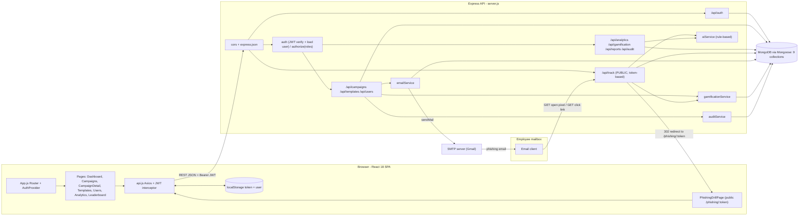
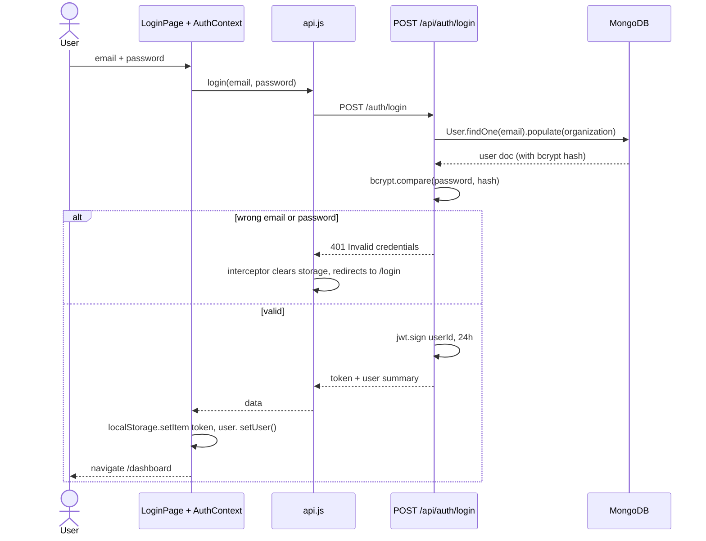
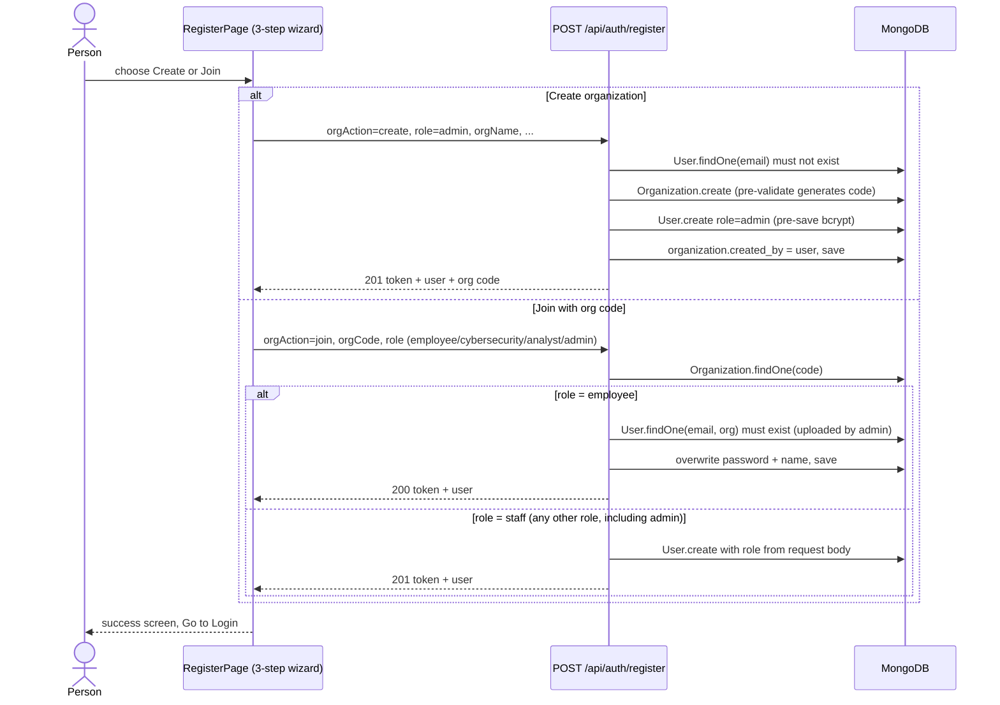
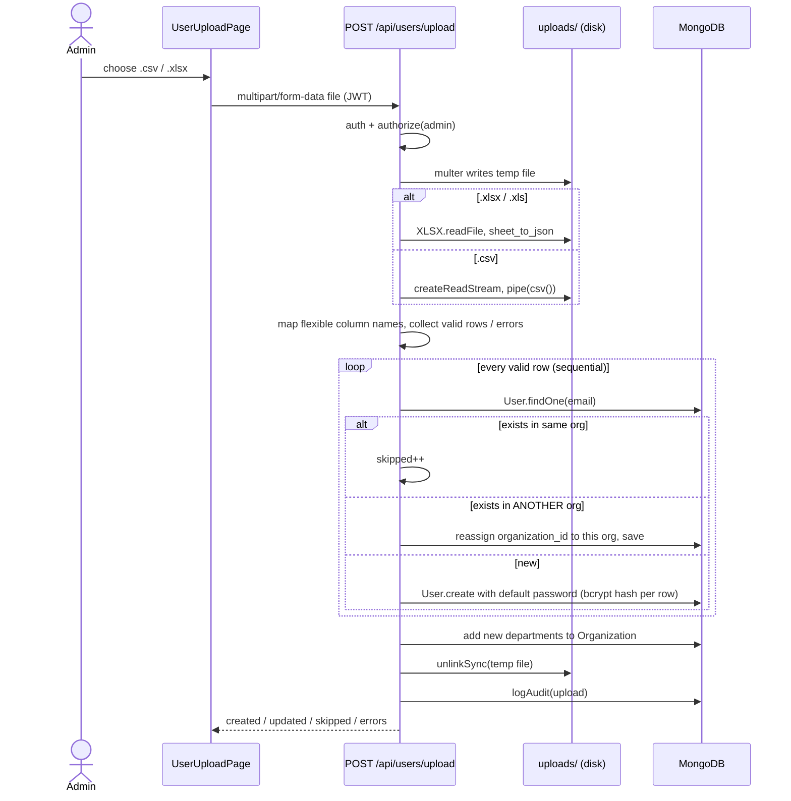
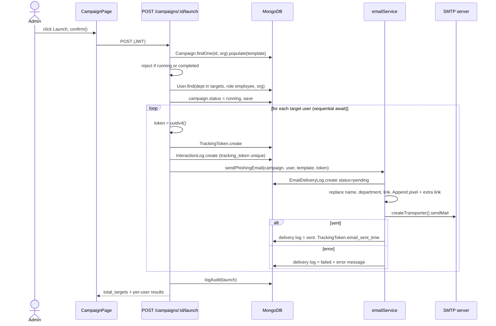
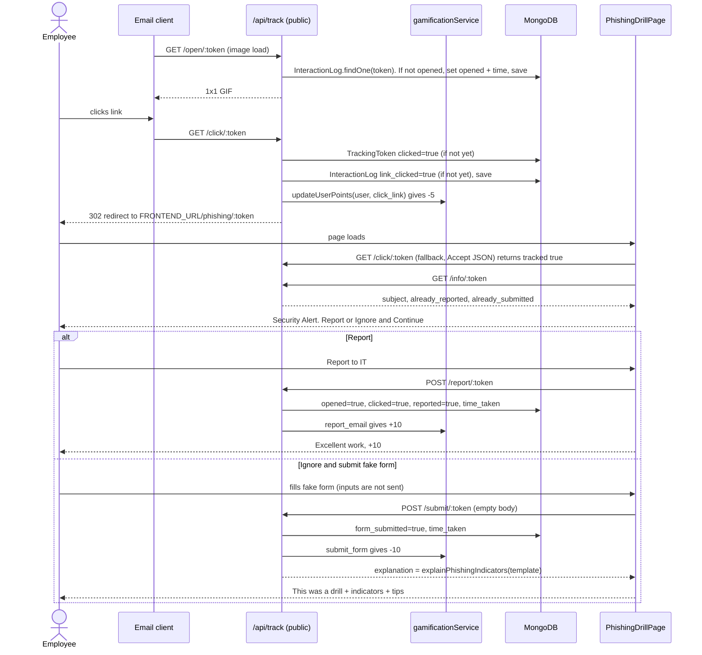
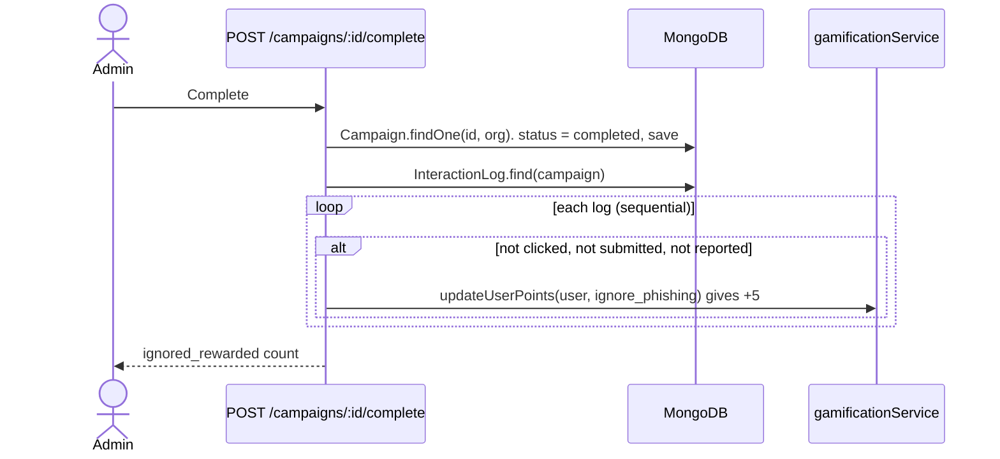
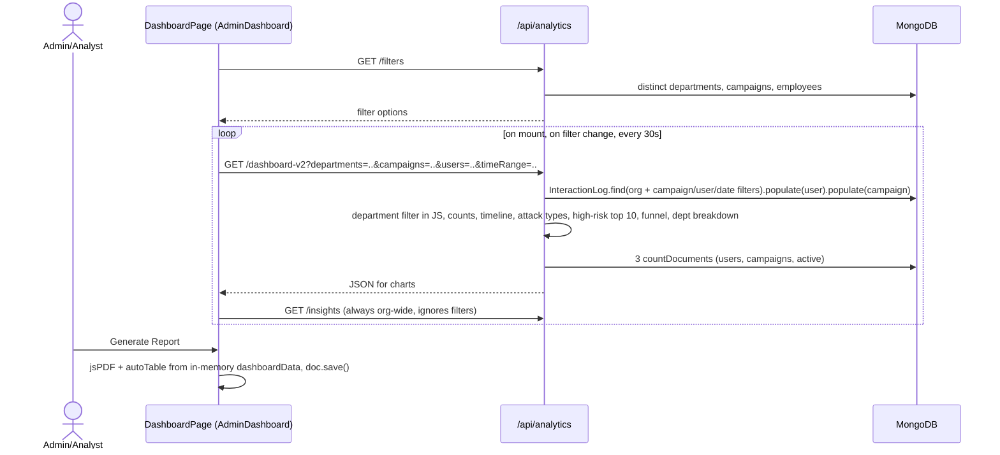
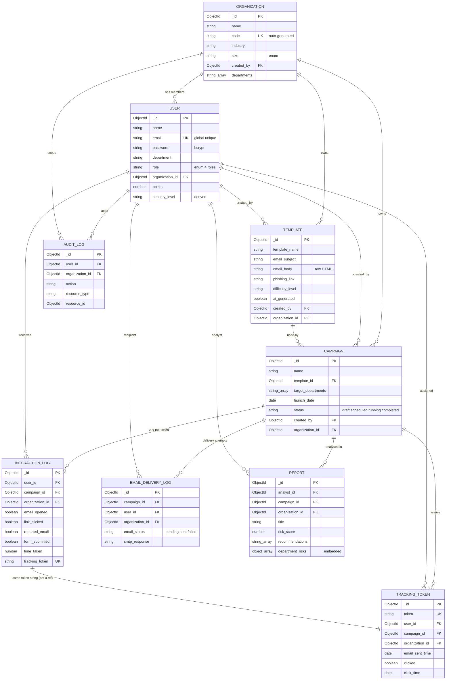

# FinShield — Project Interview Guide

> A deep, code-grounded walkthrough of the FinShield project for technical interview preparation.
> Every claim below was checked against the actual source in this workspace. File references are clickable links.

---

## How to read this guide

| Label | Meaning |
|---|---|
| ✅ **Implemented** | The code does this today. |
| ❌ **Missing** | Not in the code (even if the README implies it). |
| 🔴 **Confirmed issue** | A bug or flaw that can be shown from the code itself. |
| 🟠 **Potential risk** | Plausible problem that depends on runtime conditions (load, timing, email clients). Not proven. |
| 💭 **Hypothetical** | An interview scenario ("what if traffic grew 100×?"). |
| 📄 **Documented reason** | The README states why. |
| 🧠 **Inference** | My reasoning about why. The repo doesn't say. |

**Honesty rule for interviews.** This guide never claims that *you* hit a bug, fixed something, or achieved a metric. The README's clone URL points to a GitHub repo (`Gracy1475/Finshield`). If you weren't the only author, say which parts you built. Interviewers respect "I built X; my teammate built Y; here's how Y works."

### Analysis checklist (completed)

| Area | Files analyzed | Status |
|---|---|---|
| Root config & docs | `README.md`, `package.json`, `.gitignore`, `LICENSE` | ✅ |
| Backend entry/config | [server.js](backend/server.js), [config/db.js](backend/config/db.js), [seed.js](backend/seed.js), `backend/package.json`, lockfile versions | ✅ |
| Middleware | [middleware/auth.js](backend/middleware/auth.js) | ✅ |
| Models (9) | All files in [backend/models/](backend/models/) | ✅ |
| Routes (9) | All files in [backend/routes/](backend/routes/) | ✅ |
| Services (4) | All files in [backend/services/](backend/services/) | ✅ |
| Frontend core | [App.js](frontend/src/App.js), [api.js](frontend/src/services/api.js), [AuthContext.js](frontend/src/context/AuthContext.js), [Navbar.js](frontend/src/components/Navbar.js), [ProtectedRoute.js](frontend/src/components/ProtectedRoute.js) | ✅ |
| Frontend pages (11) | All files in [frontend/src/pages/](frontend/src/pages/) | ✅ |
| Tests | **None exist.** No `*.test.js`/`*.spec.js` files. `node_modules` isn't installed, and installing packages was out of scope, so **no tests were run.** | ✅ (reported) |
| Secrets | No `.env` file in the workspace. `.gitignore` excludes `.env`. No secrets are reproduced in this guide. | ✅ |

---

# 1. Project Overview & Interview Introductions

## 1.1 What FinShield is (simple English)

FinShield is a **phishing-simulation and security-awareness web app** for companies.

Think of it as a **fire drill for email**. A company admin sends realistic but harmless "fake phishing" emails to employees. The system records what each person does:

- Did they **open** the email? (detected with an invisible 1×1 image)
- Did they **click** the link?
- Did they **type credentials** into the fake login page?
- Did they **report** it as suspicious?

These actions become **points, badges, a leaderboard, department risk scores and PDF reports**. The company learns which teams need training, and employees learn from a "this was a drill" explanation page.

## 1.2 Users and roles (from [User.js](backend/models/User.js) `role` enum and route guards)

| Role | What they can actually do (verified in route guards) |
|---|---|
| **admin** | Everything: create/launch/reset/complete campaigns, manage templates, upload employees, view analytics, leaderboard, audit logs |
| **cybersecurity** | Manage templates, view campaigns (API), analytics, leaderboard, employee list (API) |
| **analyst** | View campaigns (API), analytics, leaderboard. **Create reports** (API only, see below) |
| **employee** | Personal dashboard only. Receives phishing emails |
| *Unauthenticated target* | Uses `/phishing/:token` drill page via email link (token = identity) |

## 1.3 Feature inventory: implemented vs. claimed

| Feature | Status | Evidence |
|---|---|---|
| Multi-tenant organizations (create / join with code) | ✅ | [routes/auth.js:10-152](backend/routes/auth.js#L10-L152) |
| JWT login, bcrypt passwords | ✅ | [routes/auth.js:155-185](backend/routes/auth.js#L155-L185), [User.js:23-27](backend/models/User.js#L23-L27) |
| Role-based access control | ✅ | [middleware/auth.js:22-29](backend/middleware/auth.js#L22-L29) |
| Phishing templates: custom HTML + 4 themes × 3 difficulties generator | ✅ | [routes/templates.js](backend/routes/templates.js), [aiService.js:192-273](backend/services/aiService.js#L192-L273) |
| Campaign create / launch / reset / complete | ✅ | [routes/campaigns.js](backend/routes/campaigns.js) |
| Email sending via SMTP with per-user tracking token | ✅ | [emailService.js:17-69](backend/services/emailService.js#L17-L69) |
| Open pixel, click redirect, report, fake-form submit tracking | ✅ | [routes/tracking.js](backend/routes/tracking.js) |
| Drill landing page with "what you should have noticed" tips | ✅ | [PhishingDrillPage.js](frontend/src/pages/PhishingDrillPage.js) |
| Points + badges (Beginner/Aware/Security Champion) | ✅ | [gamificationService.js:4-19](backend/services/gamificationService.js#L4-L19), [User.js:29-34](backend/models/User.js#L29-L34) |
| Leaderboard + department ranking + per-employee breakdown | ✅ | [routes/gamification.js](backend/routes/gamification.js), [LeaderboardPage.js](frontend/src/pages/LeaderboardPage.js) |
| Filterable admin dashboard (dept / campaign / user / time) | ✅ | [analytics.js:96-267](backend/routes/analytics.js#L96-L267), [DashboardPage.js:314](frontend/src/pages/DashboardPage.js#L314) |
| Client-side PDF export | ✅ in **DashboardPage** (README says AnalyticsDashboard) | [DashboardPage.js:387-610](frontend/src/pages/DashboardPage.js#L387-L610) |
| CSV / Excel bulk employee upload | ✅ | [routes/users.js:42-154](backend/routes/users.js#L42-L154) |
| Audit log API (admin) | ✅ API only. No frontend page | [routes/audit.js](backend/routes/audit.js) |
| Analyst reports | ⚠️ Backend exists, but **`ReportPage.js` isn't routed** in `App.js`, so it can't be reached in the UI | [App.js:17-95](frontend/src/App.js#L17-L95) |
| "AI" features | ⚠️ All **rule-based/deterministic** (keyword checks, fixed templates, formulas). No ML model or LLM | [aiService.js](backend/services/aiService.js) |
| Scheduled campaigns | ❌ `scheduled` status exists in the enum, but there's no scheduler | [Campaign.js:10](backend/models/Campaign.js#L10) |
| Automated tests | ❌ None | — |
| Real-time push (WebSockets) | ❌ Uses polling (2s / 30s) | [CampaignDetailPage.js:37-40](frontend/src/pages/CampaignDetailPage.js#L37-L40) |

**README drift you should know about (so you aren't caught out):**
- The README says the campaign page refreshes every **5s**. The code polls every **2s** ([CampaignDetailPage.js:38](frontend/src/pages/CampaignDetailPage.js#L38)).
- The README's seed admin password doesn't match what [seed.js](backend/seed.js#L40-L48) actually creates.
- The README says `GET /api/users` is admin-only. The code also allows cybersecurity and analyst ([users.js:16](backend/routes/users.js#L16)).
- The README says PDF export lives in the Analytics page. It's actually in the admin Dashboard.

## 1.4 30-second introduction

> "FinShield is a full-stack MERN app for running phishing-awareness drills inside a company. An admin uploads employees from CSV or Excel, picks or generates a phishing email template, and launches a campaign. Each email carries a unique tracking token, so the backend can record opens, clicks, fake-login submissions and reports per employee. Those events feed a points-and-badges system, a leaderboard and an analytics dashboard with department risk scores and PDF export. It's multi-tenant, uses JWT auth with four roles, and stores everything in MongoDB through Mongoose."

## 1.5 2-minute introduction

> "FinShield is a phishing-simulation and security-awareness platform. Companies need to know how their employees react to phishing, but real attacks are too costly a way to learn. FinShield runs safe drills instead.
>
> **Frontend:** React 18 with React Router, Tailwind for styling and Recharts for charts. A global AuthContext keeps the logged-in user, and an Axios instance attaches the JWT to every request. Pages are role-aware: admins see an analytics dashboard with filters and a PDF export built with jsPDF, and employees see their personal security score.
>
> **Backend:** Node and Express with a REST API split into nine route modules: auth, campaigns, templates, users, tracking, analytics, gamification, reports and audit. Two middlewares handle security: `auth` verifies the JWT and loads the user, and `authorize(...roles)` enforces role-based access. Business helpers live in services: email sending with Nodemailer, points calculation, a rule-based 'explainable' engine that lists the phishing indicators in a template, and audit logging.
>
> **Core flow:** when an admin launches a campaign, the server finds the employees in the target departments. For each one it generates a UUID tracking token, creates a tracking record, and sends an email containing a tracking pixel and a tracked link. When the employee clicks, the backend records it, deducts points and redirects them to a drill page. There they can report the email for +10 points or fall for a fake login form, which records a submission (no credentials are stored) and shows why the email was suspicious.
>
> **Data:** MongoDB with nine collections, including Users, Organizations, Campaigns, Templates and InteractionLogs. Every query is meant to be scoped by `organization_id` for tenant isolation.
>
> **What I'd improve:** tightening the registration and tenant-isolation checks, making tracking updates atomic, moving email sending to a background queue, and adding indexes and tests. I can go deeper on any of those."

*(Only say "I built" for parts you actually built.)*

---

# 2. Technology Stack & Alternatives

## 2.1 Actual stack (from `package.json` files and the lockfile)

| Layer | Technology | Version (declared) | Where used |
|---|---|---|---|
| UI library | React | ^18.2.0 | all of `frontend/src` |
| Build tooling | Create React App (`react-scripts`) | 5.0.1 | `frontend/package.json` |
| Routing | React Router | ^6.21.3 | [App.js](frontend/src/App.js) |
| Styling | Tailwind CSS (+PostCSS, autoprefixer) | ^3.4.1 | [tailwind.config.js](frontend/tailwind.config.js) |
| Charts | Recharts | ^2.12.0 | Dashboard, Analytics, Leaderboard |
| HTTP client | Axios | ^1.6.5 | [api.js](frontend/src/services/api.js) |
| PDF | jsPDF + jspdf-autotable | ^4.2.0 / ^5.0.7 | [DashboardPage.js](frontend/src/pages/DashboardPage.js#L387) |
| Server | Node.js + Express | ^4.18.2 | [server.js](backend/server.js) |
| Database | MongoDB + Mongoose ODM | ^8.1.1 (lock: 8.23.0) | [backend/models/](backend/models/) |
| Auth | jsonwebtoken, bcryptjs | ^9.0.2 / ^2.4.3 | [middleware/auth.js](backend/middleware/auth.js), [User.js](backend/models/User.js) |
| Email | Nodemailer (SMTP, Gmail App Password) | ^6.9.8 | [emailService.js](backend/services/emailService.js) |
| Upload/parsing | Multer, csv-parser, xlsx | 1.4.5-lts.2 / ^3.0.0 / 0.18.5 | [routes/users.js](backend/routes/users.js) |
| IDs | uuid (v4) | ^9.0.0 | [campaigns.js:107](backend/routes/campaigns.js#L107) |
| Misc | cors, dotenv, nodemon (dev) | — | [server.js](backend/server.js) |

> 📄 The README lists the stack but **doesn't explain why** each was chosen. Unless marked 📄, every "why" below is 🧠 inference.

## 2.2 Technology-by-technology analysis

### React 18 (Create React App)
- **What it does:** builds the UI from components. State changes re-render the page without reloading.
- **Why it fits (🧠):** this is an interactive dashboard app (filters, charts, multi-step forms, a modal panel). It's all behind login, so SEO doesn't matter, and a client-side SPA is enough.
- **Alternatives:** Next.js, Vue, Angular, Vite + React.
- **Trade-offs:** CRA is simple and zero-config but **no longer actively maintained** and slower to build than Vite. Next.js adds server rendering, which isn't needed for a logged-in dashboard. Angular is heavier and more opinionated.
- **If replaced:** moving to Vite needs almost no code change (env vars would change from `REACT_APP_*` to `VITE_*`). Next.js would change routing (file-based) and could move the API into Next route handlers.
- **When an alternative is better:** Vite for faster dev and builds today. Next.js if you add public marketing pages or need SSR.
- **Interview answer:** "React suits a highly interactive, login-only dashboard. CRA got us started with zero config. Today I'd pick Vite for faster builds, since CRA is effectively deprecated, but I wouldn't need Next.js because there's no SEO requirement."

### React Router v6
- **What:** maps URLs like `/campaigns/:id` to page components on the client.
- **Why (🧠):** multiple pages per role, plus a public `/phishing/:token` route.
- **Note:** route guarding is done by [ProtectedRoute.js](frontend/src/components/ProtectedRoute.js). That's **UX only**. Real enforcement happens on the server through `authorize()`.
- **Interview answer:** "Router v6 gives declarative nested routes. I wrap private routes in a ProtectedRoute that checks role, but I treat that as UX. The backend enforces every permission again."

### Tailwind CSS
- **What:** utility classes (`bg-slate-800 px-4`) instead of writing CSS files.
- **Why (🧠):** fast styling with a consistent look, and no separate CSS to maintain (`index.css` is only 12 lines).
- **Alternatives:** CSS Modules, styled-components, Material UI/Chakra (component libraries).
- **Trade-offs:** long class strings and repeated markup. The same `StatusBadge`/`StatCard` components are re-declared in several pages. A component library would give accessible prebuilt widgets but a more generic look.
- **Interview answer:** "Tailwind let us style quickly and consistently. The cost is verbose JSX. I'd extract repeated pieces like StatCard into shared components."

### Recharts
- **What:** React chart components (Bar, Line, Pie).
- **Why (🧠):** declarative, React-native API, and good enough for dashboard charts.
- **Alternatives:** Chart.js (canvas, faster with big data), ECharts, D3 (full control, more code).
- **Trade-off:** SVG rendering slows down with thousands of points. That's fine here because the data is aggregated first.

### Axios
- **What:** HTTP client.
- **Why (🧠):** **interceptors**. [api.js:9-27](frontend/src/services/api.js#L9-L27) attaches the JWT to every request and logs the user out on any 401.
- **Alternative:** native `fetch`, which has no interceptors and needs manual JSON handling.

### jsPDF + autotable (client-side PDF)
- **What:** builds a PDF in the browser from the dashboard data.
- **Why (🧠):** no server load, and no headless browser to deploy.
- **Alternatives:** server-side PDF (Puppeteer, PDFKit), or a print stylesheet.
- **Trade-offs:** the PDF only contains what the browser already loaded. You can't schedule or email reports from the server, and charts aren't included (tables only).
- **When alternative is better:** scheduled or emailed reports, or pixel-perfect charts → server-side Puppeteer.

### Node.js + Express
- **What:** a JavaScript server with minimal routing and middleware.
- **Why (🧠):** one language across the stack (MERN). The workload is I/O-heavy (DB and SMTP), which suits Node's non-blocking model. Express is minimal and well known.
- **Alternatives:** NestJS (structured, DI, TypeScript), Fastify (faster), Django/Spring (batteries included).
- **Trade-offs:** Express gives no structure. Here, business logic lives directly in route files (no controller/service split for most logic). Express 4 also doesn't catch rejected promises from async handlers, which is why every handler has its own try/catch (and `/me` doesn't, see §7).
- **If replaced:** NestJS would impose modules, DTO validation and guards (a natural home for RBAC). Fastify gives schema validation built in.
- **Interview answer:** "Express kept things simple and JavaScript end-to-end. As the codebase grew, I'd add structure (controllers, validation, central error handling) or migrate to NestJS."

### MongoDB + Mongoose
- **What:** a document database. Mongoose adds schemas, validation, hooks and `populate()` (reference resolution).
- **Why (🧠):** MERN convention, flexible documents (arrays like `target_departments`, `recommendations`, embedded `department_risks` in Report), and fast iteration without migrations.
- **Alternatives:** PostgreSQL (relational; this data is in fact quite relational: org → users → campaigns → logs), MySQL.
- **Trade-offs:**
  - ➕ Flexible schema, easy arrays/embedded docs, no migration files, aggregation pipeline for analytics.
  - ➖ Relationships are resolved by `populate()`, which runs extra queries rather than a DB-side join. No foreign-key constraints (deleting a template leaves campaigns pointing at nothing). Multi-document transactions need a replica set.
- **When PostgreSQL is better:** this domain has strong relationships and integrity needs (tenant → users → campaigns → logs), and analytics like "click rate by department over time" are natural `GROUP BY` + `JOIN` queries. Postgres with row-level security would also enforce tenant isolation in the database itself.
- **Interview answer (balanced):** "MongoDB let us iterate quickly and store natural arrays like target departments. To be honest, the data is fairly relational, and we pay for that with `populate()` round trips and no referential integrity. If I restarted with strict multi-tenant and reporting needs, PostgreSQL with row-level security would be a strong candidate."

### JWT (jsonwebtoken) + bcryptjs
- **What:** after login, the server signs a token `{ userId }` valid for 24h ([auth.js:166](backend/routes/auth.js#L166)). The client sends it as `Authorization: Bearer …`. bcrypt hashes passwords with cost 12 ([User.js:25](backend/models/User.js#L25)).
- **Why (🧠):** stateless auth that's easy with a separate SPA and API on different ports. bcrypt is the standard slow password hash.
- **Nuance:** the middleware still **loads the user from the DB on every request** ([middleware/auth.js:11](backend/middleware/auth.js#L11)). So role changes and deleted users take effect immediately, at the cost of one query per request.
- **Alternatives:** server sessions in Redis plus httpOnly cookie. OAuth/OIDC (Auth0, Keycloak, Azure AD). Argon2 instead of bcrypt.
- **Trade-offs:** JWTs can't be revoked before expiry without a denylist. Logout here only deletes the token client-side ([AuthContext.js:29-33](frontend/src/context/AuthContext.js#L29-L33)). Tokens in `localStorage` can be stolen by XSS.
- **Interview answer:** "JWT keeps the API stateless. Our middleware still re-reads the user each request, so permission changes apply instantly. I'd move the token to an httpOnly cookie to reduce XSS exposure and add short-lived access tokens with refresh tokens."

### Nodemailer (SMTP)
- **What:** sends email through an SMTP server (📄 README: Gmail with an App Password).
- **Why (🧠):** free, simple and works locally.
- **Alternatives:** transactional email APIs (Amazon SES, SendGrid, Mailgun, Postmark).
- **Trade-offs:** Gmail SMTP has daily sending limits and spam filtering, and a new transporter (new connection) is created **per email** ([emailService.js:26](backend/services/emailService.js#L26)). APIs offer higher throughput, bounce webhooks and delivery events.
- **Interview answer:** "SMTP via Nodemailer was enough for a prototype. In production I'd use a provider like SES, with a pooled connection or the HTTP API, plus a job queue for retries."

### Multer + csv-parser + xlsx
- **What:** Multer saves the uploaded file to `uploads/`. csv-parser streams CSV rows. xlsx parses Excel into JSON.
- **Why (🧠):** admins already keep employee lists in spreadsheets.
- **Risks:** no file size or type limits ([users.js:13](backend/routes/users.js#L13)). `xlsx@0.18.5` (the npm build) has publicly reported advisories (prototype pollution and ReDoS), and SheetJS no longer publishes fixes to npm. Multer 1.x has DoS advisories fixed in 2.x. **Verify with `npm audit` before quoting specifics.**

### uuid v4 tracking tokens
- **What:** a 122-bit random ID per (user, campaign) placed in the email links.
- **Why (🧠):** unguessable, so it can act as the identity on unauthenticated tracking routes.
- **Trade-off:** tokens never expire, and anyone holding the link (e.g. a forwarded email) acts as that user.

## 2.3 Architectural decisions

| Decision | What the code does | Pros | Cons | Better alternative when… |
|---|---|---|---|---|
| **Monolithic REST API** | One Express app, 9 routers | Simple to run and debug | Email sending and analytics share one process with user requests | Split workers out when email volume grows |
| **Shared-DB multi-tenancy** | Every doc has `organization_id`. Routes filter by it | Cheap, one DB | One missed filter = data leak (some are missed, §7.6) | DB-per-tenant or Postgres RLS for strict compliance |
| **Synchronous email sending** | Launch loops over users and `await`s SMTP inside the HTTP request ([campaigns.js:106-133](backend/routes/campaigns.js#L106-L133)) | Easy, immediate result list | Slow, long requests, no retries, partial failures | A queue (BullMQ/Redis, SQS) + worker |
| **Polling for "live" data** | 2s (campaign), 30s (dashboard, leaderboard) | No extra infrastructure | Repeated full queries, wasted requests | SSE or WebSockets (Socket.IO) + change streams |
| **Analytics computed on every request** | Load all logs, then count in JS ([analytics.js:120-236](backend/routes/analytics.js#L120-L236)) | Flexible, simple | O(all logs) per request | MongoDB aggregation, pre-aggregated stats |
| **Rule-based "AI"** | Keyword matching + fixed templates + formulas | Deterministic, explainable, free, offline | Not truly adaptive; easy to game | LLM generation (with guardrails) or ML risk models on real data |
| **Token in localStorage** | [AuthContext.js:23](frontend/src/context/AuthContext.js#L23) | Simple across ports | XSS can read it | httpOnly, SameSite cookie |
| **Points stored, scores computed** | `User.points` persisted. Security Score computed from logs on request | Points are cheap to read. Scores stay consistent with logs | Two metrics can disagree. Points drift if events are re-processed | Event log + derived projections |


---

# 3. Directory Structure & Important Files

```
Finshild-main/
├── package.json              # Root scripts: backend, frontend, seed, install-all
├── README.md                 # Features, API reference, flows (some drift, see §1.3)
├── backend/
│   ├── server.js             # Express app: CORS, JSON parsing, mounts 9 routers, /api/health
│   ├── seed.js               # Wipes DB, creates demo org, 3 staff users, 25 employees, 3 templates
│   ├── config/db.js          # mongoose.connect(MONGODB_URI). Exits process on failure
│   ├── middleware/auth.js    # auth (JWT → req.user) and authorize(...roles)
│   ├── models/               # 9 Mongoose schemas (see §6)
│   ├── routes/               # Route handlers WITH business logic (no separate controllers)
│   │   ├── auth.js           # register (create/join org), login, me, organizations
│   │   ├── campaigns.js      # CRUD, launch, reset, complete, stats
│   │   ├── tracking.js       # PUBLIC: open pixel, click, report, submit, info
│   │   ├── users.js          # list, departments, CSV/XLSX upload, add single
│   │   ├── templates.js      # CRUD + rule-based generator
│   │   ├── analytics.js      # my-stats, filters, dashboard-v2, legacy dashboard, risk-score, insights, email-delivery
│   │   ├── gamification.js   # leaderboard, department-ranking, employee/:id breakdown, departments
│   │   ├── reports.js        # analyst reports
│   │   └── audit.js          # admin audit log
│   └── services/
│       ├── emailService.js       # sendPhishingEmail(): builds HTML, pixel, link, logs delivery
│       ├── gamificationService.js# updateUserPoints(), getDepartmentRanking()
│       ├── aiService.js          # rule-based risk, insights, indicator explanation, template generator
│       └── auditService.js       # logAudit() (never throws)
└── frontend/
    ├── package.json          # CRA app ("proxy" set, but api.js uses an absolute base URL)
    └── src/
        ├── index.js / App.js # Router + AuthProvider + route table
        ├── services/api.js   # Axios instance + JWT/401 interceptors
        ├── context/AuthContext.js   # user state persisted in localStorage
        ├── components/       # Navbar (role-based links), ProtectedRoute (role gate)
        └── pages/            # 11 pages (ReportPage is NOT routed)
```

## 3.1 Key function index

| File | Function / handler | What it does |
|---|---|---|
| [middleware/auth.js:4](backend/middleware/auth.js#L4) | `auth` | Reads the Bearer token, `jwt.verify`, loads the user (minus password) into `req.user` |
| [middleware/auth.js:22](backend/middleware/auth.js#L22) | `authorize(...roles)` | 403 unless `req.user.role` is in the list |
| [models/User.js:23](backend/models/User.js#L23) | `pre('save')` ×2 | Hash password if modified. Recompute `security_level` from points |
| [models/Organization.js:17](backend/models/Organization.js#L17) | `pre('validate')` | Auto-generate org code = first 6 alphanumerics of the name + 4 random digits |
| [routes/auth.js:10](backend/routes/auth.js#L10) | `POST /register` | Create org + admin, or join an org (employee claim / staff create) |
| [routes/campaigns.js:78](backend/routes/campaigns.js#L78) | `POST /:id/launch` | Find targets → per user: TrackingToken + InteractionLog + send email |
| [routes/campaigns.js:170](backend/routes/campaigns.js#L170) | `POST /:id/complete` | Set completed. +5 points to users who did nothing |
| [routes/tracking.js:13](backend/routes/tracking.js#L13) | `GET /open/:token` | Mark opened, return a 1×1 GIF |
| [routes/tracking.js:44](backend/routes/tracking.js#L44) | `GET /click/:token` | Mark clicked, −5 points, redirect to `/phishing/:token` (or JSON if `Accept: application/json`) |
| [routes/tracking.js:91](backend/routes/tracking.js#L91) | `POST /report/:token` | Mark reported (+ opened/clicked), +10 points |
| [routes/tracking.js:130](backend/routes/tracking.js#L130) | `POST /submit/:token` | Mark submitted, −10 points, return indicator explanation |
| [routes/analytics.js:96](backend/routes/analytics.js#L96) | `GET /dashboard-v2` | Filtered org analytics: funnel, timeline, high-risk, departments |
| [routes/gamification.js:11](backend/routes/gamification.js#L11) | `GET /leaderboard` | Users + aggregation-computed security score |
| [routes/gamification.js:85](backend/routes/gamification.js#L85) | `GET /employee/:id` | Score breakdown, strengths/weaknesses ("XAI") |
| [services/emailService.js:17](backend/services/emailService.js#L17) | `sendPhishingEmail` | Create delivery log → replace `{{name}}/{{department}}/{{link}}` → send → mark sent/failed |
| [services/gamificationService.js:4](backend/services/gamificationService.js#L4) | `updateUserPoints` | Points map (+10/+5/−5/−10), floor at 0, `save()` |
| [services/aiService.js:122](backend/services/aiService.js#L122) | `explainPhishingIndicators` | Keyword checks: urgency, link, credential words, generic greeting, sender |
| [services/aiService.js:192](backend/services/aiService.js#L192) | `generatePhishingTemplate` | Lookup table: 4 themes × 3 difficulties |
| [frontend/src/services/api.js:9](frontend/src/services/api.js#L9) | interceptors | Add `Authorization`. On 401, clear storage and hard-redirect to `/login` |
| [frontend/src/pages/DashboardPage.js:387](frontend/src/pages/DashboardPage.js#L387) | `generateReport` | jsPDF tables from the already-loaded dashboard data |

---

# 4. Architecture & Diagrams

## 4.1 In simple words

FinShield is a classic **three-tier web app**:

1. **Presentation tier:** a React SPA in the browser. It only shows data and sends requests.
2. **Application tier:** an Express REST API. It checks who you are (JWT) and what you may do (role), runs the business rules (points, scoring, sending email) and talks to the database.
3. **Data tier:** MongoDB, which stores the documents.

Plus two **external actors**: an **SMTP server** (Gmail) that delivers emails, and the **employee's email client**, which loads the tracking pixel and opens the tracked link. Those requests hit public, token-based tracking routes, not the JWT-protected API.

## 4.2 Architecture diagram



## 4.3 Backend layering (what is actually there)

```
HTTP request
  → cors() + express.json()                          (server.js)
  → router (e.g. routes/campaigns.js)
      → auth            (verify JWT, User.findById)   (middleware/auth.js)
      → authorize(...)  (role check)
      → async handler   (validation + business logic + Mongoose queries, inline)
          → services/*  (email, points, rule engine, audit)
  → res.json(...)  or  catch → res.status(500).json({ message: error.message })
```

- There's **no controller layer and no validation layer**. Routes hold most of the business logic (e.g. the ~170-line `/dashboard-v2` handler).
- There's **no global error handler or 404 handler**. Each route has its own try/catch.

## 4.4 Actual API catalogue (from code, not the README)

| Router | Method & path | Guard (roles) | Notes |
|---|---|---|---|
| auth | POST `/api/auth/register` | public | create/join org |
| auth | POST `/api/auth/login` | public | returns JWT (24h) + user |
| auth | GET `/api/auth/me` | auth | **no try/catch**. Unused by frontend |
| auth | GET `/api/auth/organizations` | **public** | lists **all orgs with their join codes**. Unused by frontend |
| campaigns | GET `/` , GET `/:id`, GET `/:id/stats` | admin, cybersecurity, analyst | |
| campaigns | POST `/`, PUT `/:id`, POST `/:id/launch`, `/:id/reset`, `/:id/complete` | admin | PUT passes `req.body` straight to the update |
| templates | GET `/`, GET `/:id`, POST `/create`, PUT `/update/:id`, DELETE `/delete/:id`, POST `/generate-ai` | admin, cybersecurity | |
| users | GET `/`, GET `/departments` | admin, cybersecurity, analyst | README says admin only |
| users | POST `/upload`, POST `/add` | admin | |
| track | GET `/open/:token`, GET `/click/:token`, POST `/report/:token`, POST `/submit/:token`, GET `/info/:token` | **public** | token = identity |
| analytics | GET `/my-stats` | any logged-in user | |
| analytics | GET `/filters`, `/dashboard-v2`, `/dashboard` (legacy), `/risk-score`, `/insights`, `/email-delivery` | admin, cybersecurity, analyst | |
| gamification | GET `/leaderboard`, `/department-ranking`, `/employee/:id`, `/departments` | admin, cybersecurity, analyst | |
| reports | GET `/`, GET `/:id` | admin, analyst | |
| reports | POST `/` | analyst | |
| audit | GET `/` | admin | |
| — | GET `/`, GET `/api/health` | public | health check |

## 4.5 Frontend architecture

| Concern | Implementation |
|---|---|
| Routing | [App.js](frontend/src/App.js): public `/login`, `/register`, `/phishing/:token`. Everything else is wrapped in `ProtectedRoute roles=[…]` |
| Auth state | [AuthContext.js](frontend/src/context/AuthContext.js): `user` loaded from `localStorage` on mount. `login()` stores token + user. `logout()` clears them |
| API access | [api.js](frontend/src/services/api.js): base URL from `REACT_APP_API_URL`, adds the Bearer token, and on **any** 401 clears storage and does `window.location.href = '/login'` |
| Role-based UI | [Navbar.js](frontend/src/components/Navbar.js) link sets per role. `DashboardPage` renders `EmployeeDashboard` vs `AdminDashboard` |
| State management | Local `useState`/`useEffect` per page. No Redux, React Query or caching. Every page fetches on mount |
| "Live" updates | `setInterval` polling: CampaignDetail **2s**, Admin Dashboard **30s**, Leaderboard **30s** |
| Charts | Recharts in DashboardPage, AnalyticsDashboard, LeaderboardPage |

## 4.6 How auth + RBAC work, step by step

1. User logs in → `POST /api/auth/login` → `User.findOne({ email })` → `bcrypt.compare` → `jwt.sign({ userId }, JWT_SECRET, { expiresIn: '24h' })`.
2. Frontend saves `token` and `user` in `localStorage`.
3. Each request → interceptor adds `Authorization: Bearer <token>`.
4. Backend `auth` → `jwt.verify` → `User.findById(decoded.userId).select('-password')` → `req.user`.
5. `authorize('admin')` → compares `req.user.role`. On mismatch, returns 403.
6. The handler uses `req.user.organization_id` to scope queries (tenant isolation).

**Key point:** the role comes from the **database**, not from the token. Changing a user's role takes effect on their next request, with no re-login needed.

---

# 5. Important Request Flows

## 5.1 Login → authenticated request



> 🔴 Subtle UX bug (likely, verify in a browser): the 401 interceptor triggers on a **failed login too**, so a wrong password causes `window.location.href = '/login'` (a full reload). The error message LoginPage just set may flash and disappear. Fix: skip the redirect for `/auth/login` requests.

## 5.2 Registration (create org vs join org)



> 🔴 **Confirmed security issue.** In the "join" branch, the server trusts the **client-chosen role** ([auth.js:125](backend/routes/auth.js#L125)), and the UI even offers "Administrator" ([RegisterPage.js:435-446](frontend/src/pages/RegisterPage.js#L435-L446)). Anyone with an org code can become that org's admin. The public `GET /api/auth/organizations` endpoint hands out every org code. Details in §7.7.

## 5.3 Bulk employee upload (CSV / Excel)



## 5.4 Campaign launch (the core backend operation)



**Why it matters in interviews:** this one handler shows synchronous fan-out, no transaction, a check-then-act race on `status`, and per-email connection setup. All of these are discussed in §7.4.

## 5.5 Employee interaction: open → click → drill page → report or submit



Key facts to say out loud:
- **No credentials are captured.** The form inputs have no `name`/state ([PhishingDrillPage.js:139-151](frontend/src/pages/PhishingDrillPage.js#L139-L151)), the POST has no body, and the server reads nothing ([tracking.js:139](backend/routes/tracking.js#L139)). 📄 The README documents this as intentional.
- **The token is the identity** on public routes. A UUID v4 is effectively unguessable.
- 🔴 **Reporting is only possible after clicking.** The report button lives on the page you reach *by clicking*. So every reporter is also counted as a clicker (−5, then +10) and gets the click penalty in Security Score. See §7.2.

## 5.6 Campaign completion



> 🔴 **No guard against completing twice.** There's no `if (status === 'completed') return 400`. Calling the endpoint again awards +5 again to the same users ([campaigns.js:170-185](backend/routes/campaigns.js#L170-L185)). The UI hides the button after completion, but the API doesn't enforce it.

## 5.7 Admin dashboard (filters → analytics → PDF)



## 5.8 Leaderboard + employee breakdown

1. `LeaderboardPage` calls `/gamification/leaderboard`, `/department-ranking` and `/departments` in parallel (and again every 30s).
2. The leaderboard handler loads **up to 50 users** (`.limit(limit)`), runs **one aggregation** over all the org's `InteractionLog`s grouped by `user_id` (total/clicked/reported/submitted), computes `100 − click%·30 − submit%·40 + report%·20`, clamps it to 0–100, then sorts by score.
3. Clicking an employee → `/gamification/employee/:id` → loads their logs, computes the score breakdown, and builds rule-based strengths/weaknesses (click rate >50% = high severity, any submission = critical, average response under 30s = "reacting too quickly").

> 🔴 The `limit` is applied **before** sorting by score ([gamification.js:22-24](backend/routes/gamification.js#L22-L24) vs [line 66](backend/routes/gamification.js#L66)). In an org with more than 50 employees, the "top" list is the top of an arbitrary 50, not of everyone.


---

# 6. Database Schema & ER Diagram

## 6.1 MongoDB basics in simple English

- A **collection** is like a table. A **document** is like a row, but it's JSON-like and can contain arrays and nested objects.
- Every document has an `_id` (an **ObjectId**), which acts as the primary key.
- A "foreign key" here is just a field holding another document's `_id` (`ref: 'User'`). **MongoDB doesn't enforce it.** You can delete the referenced document and the reference silently dangles.
- **`populate()`** is Mongoose's way to "join": it runs a **second query** to fetch the referenced documents and swaps them in. It's an application-level join, not a database join.
- **Mongoose schemas** add validation (`required`, `enum`, `unique`), defaults and **hooks** (code that runs before save).
- `{ timestamps: true }` adds `createdAt` and `updatedAt` automatically to every model here.

## 6.2 Collections and fields

### `users` — [User.js](backend/models/User.js)
| Field | Type | Constraints / default | Notes |
|---|---|---|---|
| `_id` | ObjectId | PK | |
| `name` | String | required | |
| `email` | String | required, **unique (global)** | One person can belong to only one org. Not lower-cased at schema level |
| `password` | String | required | bcrypt hash (cost 12) via pre-save hook |
| `department` | String | required | Free text (no Department collection) |
| `role` | String | enum admin/cybersecurity/analyst/employee, default employee | |
| `organization_id` | ObjectId → Organization | required | Tenant key |
| `points` | Number | default 0 | Gamification. Floor 0 enforced in service |
| `security_level` | String | enum Beginner/Aware/Security Champion | Derived in pre-save from points (≤20, ≤50, >50) |

### `organizations` — [Organization.js](backend/models/Organization.js)
| Field | Type | Constraints | Notes |
|---|---|---|---|
| `name` | String | required | |
| `code` | String | required, **unique** | Auto: first 6 alphanumerics of the name, uppercased, + 4 random digits (1000–9999) |
| `industry` | String | default '' | |
| `size` | String | enum ranges | |
| `created_by` | ObjectId → User | optional | Set right after the admin is created |
| `departments` | [String] | | Maintained manually by register/upload/add |

### `campaigns` — [Campaign.js](backend/models/Campaign.js)
| Field | Type | Constraints | Notes |
|---|---|---|---|
| `name` | String | required | Also used to guess "attack type" in analytics |
| `template_id` | ObjectId → Template | required | |
| `target_departments` | [String] | | Matched against `User.department` |
| `launch_date` | Date | default now | Overwritten at launch. Not used for scheduling |
| `status` | String | enum draft/scheduled/running/completed | `scheduled` is never set automatically |
| `created_by` | ObjectId → User | required | |
| `organization_id` | ObjectId → Organization | required | |

### `templates` — [Template.js](backend/models/Template.js)
`template_name`, `email_subject`, `email_body` (raw HTML, all required), `phishing_link` (default ''), `difficulty_level` (easy/medium/hard), `ai_generated` (bool), `created_by` → User, `organization_id` → Organization.

### `interactionlogs` — [InteractionLog.js](backend/models/InteractionLog.js) (the most important collection)
| Field | Type | Notes |
|---|---|---|
| `user_id` → User, `campaign_id` → Campaign, `organization_id` → Organization | ObjectId, required | One document per (user, campaign launch) |
| `email_opened` / `email_opened_at` | Bool / Date | Set by the pixel, or inferred on report/submit |
| `link_clicked` / `link_clicked_at` | Bool / Date | |
| `reported_email` / `reported_at` | Bool / Date | |
| `form_submitted` / `form_submitted_at` | Bool / Date | |
| `time_taken` | Number (seconds) | `now − createdAt` at report or submit |
| `tracking_token` | String, **unique**, required | Links to the email URL |

### `trackingtokens` — [TrackingToken.js](backend/models/TrackingToken.js)
`token` (unique), `user_id`, `campaign_id`, `organization_id`, `email_sent_time`, `clicked`, `click_time`. This largely **duplicates** InteractionLog (same token, user, campaign and click state). See design issues.

### `emaildeliverylogs` — [EmailDeliveryLog.js](backend/models/EmailDeliveryLog.js)
`campaign_id`, `user_id`, `organization_id`, `email_status` (pending/sent/failed), `smtp_response`, `timestamp` (plus `createdAt`, which duplicates it).

### `reports` — [Report.js](backend/models/Report.js)
`analyst_id` → User, `campaign_id` → Campaign, `organization_id`, `title`, `summary`, `risk_score`, `recommendations: [String]`, **embedded** `department_risks: [{ department, risk_score, vulnerabilities: [String] }]`. This is the one place the schema uses **embedding** (a snapshot at report time).

### `auditlogs` — [AuditLog.js](backend/models/AuditLog.js)
`user_id`, `organization_id`, `action`, `resource_type`, `resource_id`, `details`, `timestamp` (plus timestamps).

## 6.3 ER diagram



*(Every model also has `organization_id` → ORGANIZATION. Some of those lines are omitted to keep the diagram readable.)*

## 6.4 Hooks (logic inside models)

| Hook | Code | Effect | Gotcha |
|---|---|---|---|
| `User.pre('save')` #1 | [User.js:23-27](backend/models/User.js#L23-L27) | Hash password only if modified | Doesn't run on `updateOne`/`findOneAndUpdate`, so all password changes must go through `save()` |
| `User.pre('save')` #2 | [User.js:29-34](backend/models/User.js#L29-L34) | Recompute `security_level` from points | Same: a future atomic `$inc` on points would **skip** this and leave the badge stale |
| `Organization.pre('validate')` | [Organization.js:17-25](backend/models/Organization.js#L17-L25) | Generate org code | Only 9,000 suffixes per name prefix, and `Math.random()` isn't cryptographic. A collision makes the unique index throw a 500, with no retry |

## 6.5 Indexes

**Existing indexes** (only from `unique: true` plus the default `_id`):
- `users.email` (unique)
- `organizations.code` (unique)
- `trackingtokens.token` (unique)
- `interactionlogs.tracking_token` (unique)

**No index exists on `organization_id`, `campaign_id`, `user_id`, `department` or `status`**, yet nearly every query filters on them. On a small demo database you won't notice. With hundreds of thousands of logs, every dashboard request becomes a **collection scan**. 🟠 *Potential risk; verify with `explain()`.*

**Recommended indexes** (tied to the actual queries):

| Collection | Index | Serves |
|---|---|---|
| interactionlogs | `{ organization_id: 1, createdAt: -1 }` | dashboard-v2 filter + time range, insights, legacy dashboard |
| interactionlogs | `{ campaign_id: 1 }` (or `{ campaign_id: 1, organization_id: 1 }`) | campaign stats (polled every 2s), complete, reset, risk score |
| interactionlogs | `{ user_id: 1, createdAt: -1 }` | my-stats, employee breakdown |
| interactionlogs | `{ campaign_id: 1, user_id: 1 }` **unique** | prevents duplicate logs if a launch runs twice (§7.4) |
| users | `{ organization_id: 1, role: 1, department: 1 }` | launch target lookup, leaderboard, distinct departments |
| campaigns | `{ organization_id: 1, createdAt: -1 }` | campaign list |
| trackingtokens | `{ campaign_id: 1 }` | reset deleteMany |
| emaildeliverylogs | `{ organization_id: 1, campaign_id: 1, timestamp: -1 }` | email-delivery endpoint |
| auditlogs | `{ organization_id: 1, timestamp: -1 }` | audit list (sorted, limited) |

**Trade-off to mention:** every index speeds up reads but slows writes slightly and uses RAM. The tracking routes write on every open and click, so add only indexes that serve real queries.

## 6.6 Query patterns used (with real examples)

| Pattern | Example in code | Explanation |
|---|---|---|
| **Create** | `Campaign.create({...})` [campaigns.js:46](backend/routes/campaigns.js#L46) | Insert one document (runs validators and hooks) |
| **Read one, scoped** | `Campaign.findOne({ _id, organization_id })` [campaigns.js:31](backend/routes/campaigns.js#L31) | Combining `_id` with the tenant key prevents cross-org reads (an IDOR defence) |
| **Read many + sort** | `Campaign.find({ organization_id }).sort({ createdAt: -1 })` | No pagination anywhere |
| **Populate ("join")** | `InteractionLog.find(...).populate('user_id', 'name email department').populate('campaign_id', ...)` [analytics.js:120-122](backend/routes/analytics.js#L120-L122) | Two extra queries using `$in` on the referenced IDs. Selecting only the needed fields is good practice |
| **Nested populate** | `.populate({ path: 'campaign_id', populate: { path: 'template_id' } })` [tracking.js:133](backend/routes/tracking.js#L133) | Log → campaign → template |
| **Update (document)** | `log.link_clicked = true; await log.save()` [tracking.js:63-66](backend/routes/tracking.js#L63-L66) | Read-modify-write, **not atomic** |
| **Update (query)** | `TrackingToken.findOneAndUpdate({ token, clicked: false }, { clicked: true, ... })` [tracking.js:108](backend/routes/tracking.js#L108) | **Atomic conditional update.** This is the right pattern, already used in one place |
| **Update with req.body** | `Campaign.findOneAndUpdate(filter, req.body, { new: true })` [campaigns.js:65-68](backend/routes/campaigns.js#L65-L68) | 🔴 Mass assignment, and `runValidators` is off so the enum isn't checked |
| **Delete many** | `InteractionLog.deleteMany({ campaign_id })` [campaigns.js:156](backend/routes/campaigns.js#L156) | Campaign reset |
| **Distinct** | `User.distinct('department', { organization_id, role: 'employee' })` | Department dropdowns |
| **Count** | `User.countDocuments({...})` | Overview cards |
| **Aggregation** | `$match` → `$group` with `$sum: { $cond: ['$link_clicked', 1, 0] }` [gamification.js:32-43](backend/routes/gamification.js#L32-L43) | Counts per user **inside the database**. The only analytics done server-side in MongoDB besides department ranking |
| **Aggregation** | `User.aggregate([$match, $group by department with $avg points, $sort])` [gamificationService.js:33-44](backend/services/gamificationService.js#L33-L44) | Department ranking |

**Example to explain populate vs SQL join.** The dashboard does `InteractionLog.find({organization_id})` (query 1), then Mongoose collects all `user_id`s and runs `User.find({_id: {$in: [...]}})` (query 2), then the same for campaigns (query 3), and stitches the results together in Node. In SQL this would be one `SELECT … FROM interaction_logs JOIN users … JOIN campaigns …`. In MongoDB, the database-side equivalent is `$lookup` inside an aggregation pipeline.

## 6.7 Transactions and migrations

- **Transactions: none.** Several operations should be all-or-nothing:
  - Register "create": `Organization.create`, then `User.create`. If the user insert fails (e.g. a duplicate email race), an **orphan organization** remains.
  - Launch: status set to `running`, then N × (token + log + email). A crash halfway leaves a "running" campaign with partial targets, and **re-launch is blocked** because status is `running` (only Reset helps).
  - Reset: deletes logs and tokens but **not** EmailDeliveryLogs, and doesn't reverse points already awarded or deducted.
- MongoDB multi-document transactions need a **replica set** (Atlas provides one, a plain local `mongod` doesn't). Emails can't be "rolled back" anyway, so for launch the better pattern is **idempotent steps + an outbox/queue**, not a DB transaction.
- **Migrations: none.** Schema lives in code. Changing a field (e.g. adding `organization_id` validation or renaming a department) needs a hand-written script. Tools like `migrate-mongo` would add versioned migrations. `seed.js` wipes all collections (except `trackingtokens`) and recreates demo data. **Never run it against real data.**

## 6.8 Database design issues

| # | Issue | Status | Why it matters | Better design |
|---|---|---|---|---|
| D1 | **TrackingToken duplicates InteractionLog** (token, user, campaign, clicked) | 🔴 Confirmed | Two sources of truth for "clicked". Twice the writes per event. They can disagree | Keep only InteractionLog (`tracking_token` is already unique), or make TrackingToken the only token store and reference it |
| D2 | **No indexes on foreign keys / tenant key** | 🔴 Confirmed absence | Collection scans as data grows | §6.5 |
| D3 | **Department is a free-text string** in 3 places (User, Campaign targets, Org list) | 🔴 Confirmed | "HR" vs "hr" become different departments. Renaming is impossible. Org list goes stale | Department collection (or a normalized key) referenced by ID |
| D4 | **Global unique email** | Design choice | A consultant can't be in two orgs. Upload "steals" users from another org (§7.6) | Unique on `(organization_id, email)`, or a membership table |
| D5 | **Emails not normalized** | 🔴 Confirmed | Upload lower-cases emails, but register/login/add don't. `Alice@x.com` won't match `alice@x.com` | `lowercase: true, trim: true` on the schema |
| D6 | **No referential integrity / cascade** | 🔴 Confirmed | Deleting a template leaves campaigns with `template_id` → null. Launching then fails every email | Block deletion when in use, or soft-delete |
| D7 | **Duplicate time fields** (`timestamp` + `createdAt`) in AuditLog, EmailDeliveryLog | 🔴 Confirmed | Confusing. Bug: `my-stats` sorts by `timestamp`, which **doesn't exist** on InteractionLog ([analytics.js:21](backend/routes/analytics.js#L21)), so "recent activity" isn't sorted and its `date` is undefined | Use `createdAt` everywhere |
| D8 | **Stored `points` vs computed scores** | Design trade-off | Points are cheap to read but drift if events are double-counted (§7.3, §7.5) | Event-sourced points ledger (`PointsTransaction` with a unique `(user, campaign, action)`), with points as a cached sum |
| D9 | **Unbounded growth** of logs and audit entries | 🟠 Risk | Storage and scan cost grow forever | Retention policy, TTL index on audit logs if acceptable, archival |
| D10 | **No `campaign_id + user_id` uniqueness** | 🔴 Confirmed | A double launch creates 2 logs per user, double-counting analytics | Compound unique index |


---

# 7. Technical Challenges

> This section couldn't be generated in this session. The most important code-level findings are already in §1.3 (README drift), §5 (flow notes marked 🔴) and §6.8 (database design issues), and they're summarized again in §8 and §9.

---

# 8. Security, Performance & Scalability

## 8.1 What the project already does well ✅

| Practice | Evidence |
|---|---|
| Passwords hashed with bcrypt, cost 12 | [User.js:25](backend/models/User.js#L25) |
| Password excluded from user queries | `.select('-password')` in [middleware/auth.js:11](backend/middleware/auth.js#L11), [users.js:21](backend/routes/users.js#L21) |
| Generic login error ("Invalid credentials") for both an unknown email and a wrong password | [auth.js:159-165](backend/routes/auth.js#L159-L165) |
| JWT expiry (24h) | [auth.js:166](backend/routes/auth.js#L166) |
| Role loaded from the DB on every request (no stale roles in the token) | [middleware/auth.js:11](backend/middleware/auth.js#L11) |
| Most queries scoped by `organization_id` (`findOne({ _id, organization_id })`) | campaigns, templates, reports, gamification |
| Simulated login form captures no credentials | [tracking.js:139](backend/routes/tracking.js#L139), [PhishingDrillPage.js:139-151](frontend/src/pages/PhishingDrillPage.js#L139-L151) |
| Secrets read from environment variables. `.env` is git-ignored | [.gitignore](.gitignore) |
| Audit trail of admin actions | [auditService.js](backend/services/auditService.js) |

## 8.2 Security review (prioritized)

Severity is my own assessment. Each item is described with its defensive fix.

| # | Severity | Finding | Evidence | Recommended fix |
|---|---|---|---|---|
| S1 | **Critical** | Joining an org trusts the **role sent by the client**, including `admin` | [auth.js:108-126](backend/routes/auth.js#L108-L126), [RegisterPage.js:435-446](frontend/src/pages/RegisterPage.js#L435-L446) | Join always creates `employee` (or a pending request). Elevated roles only granted by an existing admin through an authenticated endpoint |
| S2 | **Critical** | Public endpoint lists **every organization and its join code** | [auth.js:194-201](backend/routes/auth.js#L194-L201) | Remove it (the frontend doesn't use it), or require auth and drop `code` from the output |
| S3 | **High** | Employee "join" overwrites the password of any pre-uploaded account given its email + org code | [auth.js:76-89](backend/routes/auth.js#L76-L89) | One-time **invite tokens** emailed to the employee, expiring and single-use. Refuse if the account was already activated |
| S4 | **High** | Hard-coded default password for uploaded/added employees, published in the README | [users.js:50](backend/routes/users.js#L50), [users.js:169](backend/routes/users.js#L169) | No usable default password: create accounts as "invited" with a random unusable hash, activated by invite link |
| S5 | **High** | Upload **reassigns users that belong to another organization** | [users.js:117-125](backend/routes/users.js#L117-L125) | Never move users across tenants. Report them as conflicts. Long-term: unique `(organization_id, email)` |
| S6 | **High** | Template HTML rendered with `dangerouslySetInnerHTML` (stored XSS risk). Combined with the JWT in `localStorage`, the token is exposed | [TemplatePage.js:190](frontend/src/pages/TemplatePage.js#L190), [AuthContext.js:23](frontend/src/context/AuthContext.js#L23) | Sanitize with DOMPurify, or render the preview in a sandboxed `<iframe sandbox>`. Sanitize on save server-side too. Consider httpOnly cookies |
| S7 | **High** | Update endpoints pass `req.body` straight to Mongoose (mass assignment), e.g. `organization_id`, `status`. `runValidators` is off | [campaigns.js:65-68](backend/routes/campaigns.js#L65-L68), [templates.js:57-60](backend/routes/templates.js#L57-L60) | Whitelist fields (`pick(req.body, ['name','template_id','target_departments'])`). Add `{ runValidators: true }` |
| S8 | **Medium** | Some queries aren't tenant-scoped: `calculateDepartmentRiskScores(campaignId)` is used with client-supplied IDs | [aiService.js:16](backend/services/aiService.js#L16), [analytics.js:343-345](backend/routes/analytics.js#L343-L345), [reports.js:28](backend/routes/reports.js#L28) | First verify `Campaign.findOne({ _id, organization_id })`. Pass `orgId` into the service and include it in the query |
| S9 | **Medium** | No rate limiting on login/register/tracking | [server.js](backend/server.js) | `express-rate-limit` (or at the gateway), plus account lockout and backoff on login |
| S10 | **Medium** | No input validation library. IDs aren't validated (invalid ObjectId → 500) | all routes | `zod`/`joi`/`express-validator` schemas per route. Check `mongoose.isValidObjectId` |
| S11 | **Medium** | CORS reflects **any** origin with `credentials: true` (the "allowed" list is never enforced) | [server.js:12-29](backend/server.js#L12-L29) | Enforce an allow-list for the authenticated API. Only the public tracking routes need a permissive policy |
| S12 | **Medium** | Raw `error.message` returned to clients | every `catch` block | Central error middleware: log details server-side, return a generic message + request ID |
| S13 | **Medium** | Upload has no size/type limits. Temp file isn't deleted on errors. `xlsx@0.18.5` and `multer@1.x` have published advisories | [users.js:13](backend/routes/users.js#L13), [users.js:147](backend/routes/users.js#L147) | `multer({ limits: { fileSize }, fileFilter })`, delete in `finally`, upgrade multer, switch to SheetJS's maintained distribution or another parser. Run `npm audit` |
| S14 | **Low** | No security headers | [server.js](backend/server.js) | `helmet()` |
| S15 | **Low** | User/CSV values inserted into email HTML without escaping | [emailService.js:31-34](backend/services/emailService.js#L31-L34) | HTML-escape `name`/`department` before substitution |
| S16 | **Low** | No logout invalidation or refresh tokens. 24h tokens in `localStorage` | [AuthContext.js](frontend/src/context/AuthContext.js) | Short-lived access token + rotating refresh token in an httpOnly cookie |
| S17 | **Low** | Weak password policy (min 6 chars, checked only in the frontend) | [RegisterPage.js:49](frontend/src/pages/RegisterPage.js#L49) | Enforce server-side. Check against breached-password lists |

### Secret management
- ✅ Secrets come from `process.env` (`JWT_SECRET`, `SMTP_PASS`, `MONGODB_URI`) and `.env` isn't committed.
- ➖ No startup check: if `JWT_SECRET` is missing, signing fails at runtime. Add a config validator that refuses to start without required variables.
- ➖ For production: a secret manager (AWS Secrets Manager, Vault, Doppler), rotation of `JWT_SECRET` (support two keys during rotation), and a separate SMTP credential per environment.

## 8.3 Performance review

| # | Issue | Status | Evidence | Improvement |
|---|---|---|---|---|
| P1 | Analytics load **every** interaction log for the org, populate users and campaigns, then count in JavaScript | 🔴 design | [analytics.js:120-236](backend/routes/analytics.js#L120-L236), [aiService.js:43-62](backend/services/aiService.js#L43-L62) | MongoDB aggregation (`$match` → `$lookup` → `$group`/`$facet`) returning only the numbers |
| P2 | Missing indexes on `organization_id`, `campaign_id`, `user_id` | 🔴 confirmed absence | models | §6.5 |
| P3 | Polling: campaign page every **2s** loads all logs with populate. Dashboard every 30s runs dashboard-v2 + insights | 🔴 design | [CampaignDetailPage.js:37-40](frontend/src/pages/CampaignDetailPage.js#L37-L40), [DashboardPage.js:381-384](frontend/src/pages/DashboardPage.js#L381-L384) | Longer intervals, pause when the tab is hidden (`document.visibilityState`), return counts only, or SSE |
| P4 | No pagination on any list (users, campaigns, logs, templates, delivery logs) | 🔴 | all list routes | `limit`/cursor pagination (`_id > lastId`) |
| P5 | `/risk-score` runs one query per campaign | 🔴 | [analytics.js:349-352](backend/routes/analytics.js#L349-L352) | Single aggregation grouped by department |
| P6 | Bulk upload: `findOne` + `create` per row, each hashing a password with bcrypt cost 12 | 🔴 | [users.js:110-134](backend/routes/users.js#L110-L134) | One `find({ email: { $in } })`, then `insertMany`. Invite-based accounts avoid hashing entirely |
| P7 | Leaderboard aggregates every log in the org on every call | 🔴 | [gamification.js:32-43](backend/routes/gamification.js#L32-L43) | Index + cache, or maintain per-user counters |
| P8 | New SMTP transporter per email | 🔴 | [emailService.js:26](backend/services/emailService.js#L26) | One pooled transporter (`pool: true`) created at startup |

**How to measure before optimizing (no numbers are claimed here):**
1. Seed realistic volume (e.g. a script creating 50k logs).
2. Enable the Mongoose debug log (`mongoose.set('debug', true)`) and time requests (e.g. the `morgan` response-time token).
3. Run `db.interactionlogs.find({...}).explain('executionStats')` and look for `COLLSCAN` and `totalDocsExamined` vs `nReturned`.
4. Add the index or aggregation, then measure again with the same data.

## 8.4 How the system could evolve under much higher load (💭)

| Stage | Changes |
|---|---|
| **1. Quick wins** | Indexes (§6.5), aggregation pipelines instead of in-memory counting, pagination, a pooled SMTP transporter, input validation, helmet, rate limiting |
| **2. Separate slow work** | Move email sending into a background worker with a job queue (e.g. BullMQ + Redis) and a transactional email provider (SES/SendGrid). Replace polling with SSE/WebSockets for the live campaign page. Cache leaderboard/insights in Redis for short periods |
| **3. Scale out** | Run several stateless API instances behind a load balancer (JWT auth already makes this easy). Serve the React build from a CDN. MongoDB replica set (high availability + transactions). Later, **shard by `organization_id`** |
| **4. Analytics at scale** | Pre-aggregate daily stats per org/department/campaign (scheduled job writing to a summary collection with `$merge`), so dashboards read small summaries instead of raw logs. Archive old logs |
| **Observability throughout** | Structured logging (pino), request IDs, metrics (latency, error rate, email failures), alerts, health checks that also check the DB |

---

# 9. Code Quality & Improvement Roadmap

## 9.1 Code organization

- **Fat route handlers.** Business logic, validation and data access live together in route files (e.g. the ~170-line `/dashboard-v2`). Splitting into **controllers** (HTTP) → **services** (rules) → **models** (data) would make it testable.
- **Services exist but are used unevenly.** `gamificationService` and `aiService` are good starts. `campaigns.js` even uses `require('../services/gamificationService')` inline inside a loop ([campaigns.js:182](backend/routes/campaigns.js#L182)) instead of importing once at the top.
- **Naming mix:** database fields use `snake_case` while JavaScript uses `camelCase`, and API responses mix both (`total_targets` vs `recentActivity`).

## 9.2 Duplicated logic

| Logic | Places | Fix |
|---|---|---|
| Security Score formula (100 − click·30 − submit·40 + report·20) | [analytics.js:29-35](backend/routes/analytics.js#L29-L35), [gamification.js:48-54](backend/routes/gamification.js#L48-L54), [gamification.js:107-113](backend/routes/gamification.js#L107-L113) | One `scoring.js` module with unit tests |
| Risk formulas, **4 different versions** | timeline `(c·20+s·30)/n` [analytics.js:159](backend/routes/analytics.js#L159), dept breakdown subtracts reports [analytics.js:233](backend/routes/analytics.js#L233), high-risk `(c·20+s·40)/n·(100/60)` [analytics.js:203](backend/routes/analytics.js#L203), `calculateDepartmentRiskScores` [aiService.js:32-34](backend/services/aiService.js#L32-L34) | Define each metric once and document it |
| Department stats loop | `/dashboard-v2`, legacy `/dashboard`, `generateDashboardInsights` | Shared aggregation |
| User response object (id, name, email, role, org…) | 4 times in [auth.js](backend/routes/auth.js) | `toAuthResponse(user, org)` helper |
| `StatCard`, `StatusBadge`, loading spinners | several pages | `frontend/src/components/` |

## 9.3 Dead or unreachable code

- `calculateUserRiskScore` (exported, never used) in [aiService.js:5](backend/services/aiService.js#L5).
- `getLeaderboard` (imported in gamification routes, never called).
- `ReportPage.js` (not routed). The audit log has an API but no page.
- Legacy `/api/analytics/dashboard` is still used by `AnalyticsDashboard.js`, while the admin Dashboard uses `/dashboard-v2`. That's two analytics views with different numbers.
- `const [, setInfo]` in [PhishingDrillPage.js:7](frontend/src/pages/PhishingDrillPage.js#L7) stores data that's never read.
- A useless `findOneAndUpdate(..., { $setOnInsert: {} }, { upsert: false })` in [tracking.js:18-22](backend/routes/tracking.js#L18-L22).

## 9.4 Smaller confirmed bugs

| Bug | Evidence | Fix |
|---|---|---|
| Employee dashboard shows **100** when the real score is **0** (`0 \|\| 100`) | [DashboardPage.js:102](frontend/src/pages/DashboardPage.js#L102) | `stats.security_score ?? 100` |
| Badge colors reference levels that don't exist ("Intermediate", "Advanced", "Expert"), and "Security Champion" falls back to gray | [DashboardPage.js:49-58](frontend/src/pages/DashboardPage.js#L49-L58) | Use the 3 real levels |
| `my-stats` sorts by a non-existent `timestamp` field, so recent activity is unsorted and `date` is undefined | [analytics.js:21](backend/routes/analytics.js#L21), [analytics.js:39](backend/routes/analytics.js#L39) | Sort by and return `createdAt` |
| Leaderboard limits before sorting | [gamification.js:22-24](backend/routes/gamification.js#L22-L24) | Aggregate scores for all users, sort, then limit |
| Campaign can be completed repeatedly, re-awarding points | [campaigns.js:170-185](backend/routes/campaigns.js#L170-L185) | Only allow `running → completed` |
| "No Action" slice subtracts reporters twice (reporters are always also clickers) | [AnalyticsDashboard.js:53](frontend/src/pages/AnalyticsDashboard.js#L53) | Count logs with none of the flags |
| `GET /api/auth/me` has no try/catch (in Express 4 a DB error becomes an unhandled rejection) | [auth.js:188-191](backend/routes/auth.js#L188-L191) | try/catch or an async wrapper |
| `isPhishingPage` reads `window.location` (doesn't react to navigation) | [App.js:99](frontend/src/App.js#L99) | `useLocation()` |
| Empty-state text says "every 5 seconds", the interval is 2s | [CampaignDetailPage.js:127](frontend/src/pages/CampaignDetailPage.js#L127) | Align text and interval |

## 9.5 Testing strategy (no tests exist today)

| Level | Tooling | What to test first |
|---|---|---|
| Unit | Jest | Scoring and risk formulas, `explainPhishingIndicators`, `generatePhishingTemplate`, security-level thresholds, org code format |
| API integration | Jest + Supertest + `mongodb-memory-server` | Auth (login, expired/invalid token), RBAC (each role on each endpoint → 403s), **tenant isolation** (org A can't read org B), upload parsing, campaign lifecycle transitions, tracking endpoints |
| Frontend | React Testing Library (already in `package.json`) | ProtectedRoute redirects, LoginPage error display, DashboardPage role split |
| End-to-end | Playwright or Cypress | Register org → upload CSV → create template → create/launch campaign (SMTP stubbed, e.g. Ethereal/MailHog) → open drill link → report → verify dashboard |
| Security | `npm audit`, ESLint security plugin, OWASP ZAP baseline scan | Dependency advisories, headers, injection |

## 9.6 Prioritized improvement roadmap

| Priority | Item | Why |
|---|---|---|
| **P0 – Security** | Fix role assignment on join (S1), remove the public org list (S2), invite-based onboarding replacing default passwords (S3, S4), stop cross-tenant reassignment (S5) | Account and tenant takeover risks |
| **P0 – Security** | Sanitize template HTML (S6), whitelist update fields (S7), scope all campaign lookups by org (S8) | XSS and data exposure |
| **P1 – Correctness** | Lifecycle checks on complete/reset, fix leaderboard ordering, `my-stats` sort, `?? 100`, scoring module with unit tests | Wrong numbers erode trust in the product |
| **P1 – Hardening** | Validation layer, central error handler, helmet, rate limiting, CORS allow-list, upload limits, dependency upgrades | Baseline production readiness |
| **P2 – Performance** | Indexes, aggregation pipelines, pagination, pooled SMTP, smarter polling | Needed before real data volumes |
| **P2 – Architecture** | Background email worker + provider, remove TrackingToken duplication | Reliability at scale |
| **P3 – Maintainability** | Controllers/services split, shared UI components, remove dead code, route ReportPage and add an audit page, update the README, CI with tests, consider TypeScript and Vite | Long-term velocity |


---

# 10. Interview Questions & Answers

> Each answer has a short version you can say, a concrete example from the code, and likely follow-ups.
> If a question is about something you didn't personally build, start with: *"That part was built by ___; here's how it works…"*

## A. Project overview & technology stack

### Q1. Explain your project in simple terms.
**Answer:** FinShield is a phishing-awareness training platform. Admins send safe, simulated phishing emails to employees. The system tracks who opens, clicks, enters credentials on a fake page, or reports the email, and turns that into scores, a leaderboard and department risk reports.
**Example:** each email contains a unique UUID link like `/api/track/click/<token>`. Clicking it marks `link_clicked` on that employee's `InteractionLog` and sends them to a "this was a drill" page.
**Follow-ups:**
- *Who are the users?* Four roles (admin, cybersecurity, analyst, employee), plus the unauthenticated email recipient identified by token.
- *Does it store real passwords from the fake form?* No. The form fields aren't sent and the server reads no body ([tracking.js:139](backend/routes/tracking.js#L139)).

### Q2. Explain your complete project architecture. *(required)*
**Answer:** It's a three-tier MERN application. A React SPA talks to an Express REST API over JSON with a JWT in the `Authorization` header. The API has nine routers, protected by an `auth` middleware (verifies the JWT and loads the user) and `authorize(...roles)` (RBAC). Helper services handle email (Nodemailer/SMTP), points, rule-based explanations and audit logging. Data lives in MongoDB through Mongoose with nine collections, all carrying an `organization_id` for multi-tenancy. A separate public `/api/track` router receives the pixel and link requests coming from email clients.
**Example:** see the diagram in §4.2. Launch goes `CampaignPage → POST /campaigns/:id/launch → User.find(targets) → TrackingToken + InteractionLog per user → emailService → SMTP`.
**Follow-ups:**
- *Why is tracking public?* Email clients and recipients aren't logged in. The unguessable token identifies the user instead.
- *Is there a controller layer?* No. Logic sits in route handlers. I'd introduce controllers and services to make it testable.

### Q3. Why did you choose this technology stack? *(required)*
**Answer:** (Be clear these are reasons, not documented decisions.) One language end to end (JavaScript), which keeps context-switching low. React suits an interactive, login-only dashboard. Express is minimal and well known. MongoDB allowed quick iteration with arrays like `target_departments`. JWT works well with a separate SPA and API. Nodemailer was the simplest way to send real email during development.
**Example:** Axios interceptors in [api.js](frontend/src/services/api.js) attach the token everywhere, and Recharts renders the dashboard charts directly from JSON.
**Follow-ups:**
- *Would you choose it again?* Mostly, but Vite instead of CRA, and I'd seriously consider PostgreSQL because the data is relational.
- *Any downside you felt?* Mongoose `populate()` causes multiple queries, and there's no referential integrity.

### Q4. Why MongoDB and not PostgreSQL or MySQL? *(alternatives)*
**Answer:** MongoDB offered schema flexibility and easy arrays and embedded documents, for example `Report.department_risks` is embedded as a snapshot. The honest trade-off: the domain is relational (org → users → campaigns → logs), so we rely on `populate()` instead of joins and have no foreign-key constraints.
**Example:** deleting a template leaves `Campaign.template_id` pointing at nothing. Postgres would block that with a foreign key.
**Follow-ups:**
- *When would you switch?* If reporting grows (complex joins and group-bys) or strict tenant isolation is required. Postgres row-level security can enforce `organization_id` in the database.
- *How would you do a join in MongoDB?* `$lookup` in an aggregation pipeline.

### Q5. Why Express and not NestJS, Django or Spring Boot?
**Answer:** Express has a small learning curve and was enough for a REST API of this size. The cost is no enforced structure: validation, error handling and layering are up to us, and here they're mostly missing.
**Example:** each handler repeats `try/catch → res.status(500).json({ message: error.message })`. NestJS would provide exception filters, DTO validation and guards (a natural place for RBAC).
**Follow-ups:**
- *What would you add to Express?* A validation library (zod), a central error middleware, an async handler wrapper, helmet and rate limiting.

### Q6. Why React (Create React App) rather than Next.js or Angular?
**Answer:** The app is entirely behind login, so server-side rendering and SEO add little. React's component model fits dashboards. CRA provided zero-config setup. Today I'd use Vite because CRA is no longer maintained.
**Example:** [App.js](frontend/src/App.js) is a single route table with `ProtectedRoute` wrappers, which is simple client-side routing.
**Follow-ups:**
- *Any state management library?* No. Local state + one AuthContext. React Query would add caching, de-duplication and refetch-on-focus, replacing the manual polling.

## B. Architecture & request flows

### Q7. How does data flow through your application? *(required)*
**Answer:** User action → React component → Axios (adds the JWT) → Express router → `auth` (JWT verify + `User.findById`) → `authorize` (role) → handler queries MongoDB scoped by `req.user.organization_id` → JSON response → React state update → re-render. The tracking flow is different: email client → public `/api/track/*` → update InteractionLog and points → redirect to the React drill page.
**Example:** the dashboard: filter change → `GET /analytics/dashboard-v2?departments=Finance` → `InteractionLog.find({organization_id})` + populate → counts computed → Recharts.
**Follow-ups:**
- *Where is data cached?* Only the user object in `localStorage`. Nothing is cached server-side.
- *How do you keep the UI fresh?* Polling (2s campaign detail, 30s dashboard and leaderboard).

### Q8. Walk me through creating and launching a campaign.
**Answer:** The admin creates a campaign (name, template, target departments), which is saved as `draft`. On launch, the server checks the campaign belongs to the admin's org and isn't already running or completed, finds employees in the target departments, marks the campaign `running`, and for each employee generates a UUID, creates a `TrackingToken` and an `InteractionLog`, and calls `sendPhishingEmail`. That replaces the `{{name}}`, `{{department}}` and `{{link}}` placeholders, adds a tracking pixel, sends via SMTP and records an `EmailDeliveryLog` as sent or failed. Finally it writes an audit entry.
**Example:** [campaigns.js:78-146](backend/routes/campaigns.js#L78-L146), [emailService.js:17-69](backend/services/emailService.js#L17-L69).
**Follow-ups:**
- *Where do you see delivery failures?* `GET /api/analytics/email-delivery` returns sent/failed/pending counts and SMTP responses.
- *How would you improve it?* Send through a background worker and a transactional email provider rather than inside the HTTP request.

### Q9. How does open and click tracking work?
**Answer:** Each email has a 1×1 transparent GIF pointing at `/api/track/open/:token`. When the client loads images, we set `email_opened`. The link points at `/api/track/click/:token`, which sets `link_clicked`, deducts 5 points and redirects to `/phishing/:token` on the frontend.
**Example:** the pixel is a base64 GIF written with `Content-Type: image/gif` ([tracking.js:33-35](backend/routes/tracking.js#L33-L35)). Errors still return 200 so nothing is revealed to the recipient.
**Follow-ups:**
- *How accurate are opens?* Approximate. Many clients block or proxy images, so opens are a soft metric. We also infer an open when a user reports or submits.
- *Why a UUID?* 122 random bits make it practically unguessable, so it can identify the user without a login.

### Q10. How do you implement multi-tenancy?
**Answer:** Shared database, shared collections, with an `organization_id` on every document. The logged-in user's org comes from the database (`req.user.organization_id`) and is added to queries, e.g. `Campaign.findOne({ _id: req.params.id, organization_id })`, which returns 404 for another org's campaign.
**Example:** [campaigns.js:31](backend/routes/campaigns.js#L31), [templates.js:24](backend/routes/templates.js#L24).
**Follow-ups:**
- *Weaknesses?* Isolation depends on every query remembering the filter. A few helpers don't (e.g. `calculateDepartmentRiskScores(campaignId)`). A Mongoose plugin or repository layer that always injects `organization_id` would make it systematic.
- *Alternatives?* Database per tenant (strong isolation, more ops work) or Postgres row-level security.

### Q11. How does the "real-time" campaign view work?
**Answer:** It's polling, not push: `setInterval` every 2 seconds calls `GET /campaigns/:id` and `GET /campaigns/:id/stats`, with cleanup in the `useEffect` return.
**Example:** [CampaignDetailPage.js:37-40](frontend/src/pages/CampaignDetailPage.js#L37-L40).
**Follow-ups:**
- *Downsides?* Each open tab re-downloads every log for the campaign every 2s.
- *Better options?* Server-Sent Events (one-way, simple) or WebSockets fed by MongoDB change streams. At minimum, pause polling when the tab is hidden and return only counts.

## C. Frontend implementation

### Q12. How do you manage authentication state in React?
**Answer:** An `AuthContext` provides `user`, `login`, `logout` and `loading`. On mount it restores the user from `localStorage`. `login()` calls the API, stores the token and user, and updates state. The Axios request interceptor adds the token. The response interceptor clears storage and redirects to `/login` on any 401.
**Example:** [AuthContext.js](frontend/src/context/AuthContext.js), [api.js](frontend/src/services/api.js).
**Follow-ups:**
- *Problem with the cached user?* It's never refreshed. Points and role shown in the UI can be stale until the next login. `/api/auth/me` exists but is unused.
- *Problem with the 401 redirect?* It also fires on a failed login, causing a reload that can wipe the error message. Exclude the login request from it.

### Q13. How do protected routes work, and is a frontend role check enough?
**Answer:** `ProtectedRoute` shows a loader while auth restores, redirects to `/login` if there's no user, and to `/dashboard` if the role isn't allowed. It's **not** security: anyone can edit `localStorage` or call the API directly. The real enforcement is `authorize(...)` on every backend route.
**Example:** [ProtectedRoute.js](frontend/src/components/ProtectedRoute.js) vs [middleware/auth.js:22-29](backend/middleware/auth.js#L22-L29).
**Follow-ups:**
- *Any mismatches between frontend and backend roles?* Yes: the backend allows cybersecurity and analyst to `GET /api/users`, while the frontend only shows the Users page to admins.

### Q14. How is the PDF report generated?
**Answer:** Entirely in the browser with jsPDF and jspdf-autotable, from the dashboard data already in memory: header band, overview table, interaction metrics, funnel, attack types, top high-risk employees, department summary, page footers, then `doc.save()`.
**Example:** `generateReport` in [DashboardPage.js:387-610](frontend/src/pages/DashboardPage.js#L387-L610).
**Follow-ups:**
- *Pros and cons?* No server cost, but no scheduled or emailed reports and no charts in the PDF. Server-side rendering (Puppeteer) would enable those.

### Q15. How do the dashboard filters work end to end?
**Answer:** `GET /analytics/filters` provides departments, campaigns and employees. A reusable `MultiSelectDropdown` keeps selections, with `'all'` as a special value. Any change rebuilds the query string, and because `fetchDashboardData` is a `useCallback` depending on the filters, the effect re-runs. The backend applies campaign, user and date filters in the Mongo query and the department filter in JavaScript after populate.
**Example:** [DashboardPage.js:344-373](frontend/src/pages/DashboardPage.js#L344-L373), [analytics.js:99-127](backend/routes/analytics.js#L99-L127).
**Follow-ups:**
- *Why is the department filter applied in JS?* Department lives on the User, not the log. A better approach: look up the matching user IDs first (`User.find({department})`), or `$lookup` in an aggregation.
- *Do insights respect filters?* No, `/insights` is always org-wide, which is a small inconsistency.

## D. Backend implementation

### Q16. How do JWT authentication and RBAC work in your middleware?
**Answer:** `auth` strips `Bearer `, verifies the signature and expiry with `JWT_SECRET`, loads the user without the password, and attaches it to `req.user`. Any failure returns 401. `authorize(...roles)` is a higher-order function returning middleware that returns 403 if `req.user.role` isn't in the list. Routes chain them: `router.post('/', auth, authorize('admin'), handler)`.
**Example:** [middleware/auth.js](backend/middleware/auth.js).
**Follow-ups:**
- *Why load the user each time if the JWT is stateless?* So deleted users and role changes take effect immediately. The cost is one indexed `_id` lookup per request.
- *How would you revoke tokens?* Short expiry + refresh tokens, or a token version on the user that's checked during verification.

### Q17. How does the gamification system work?
**Answer:** A points map in `updateUserPoints`: report +10, ignore +5 (granted when the campaign is completed), click −5, submit −10, with a floor of 0. A `pre('save')` hook converts points to a badge: ≤20 Beginner, ≤50 Aware, otherwise Security Champion. Separately, a 0–100 Security Score is computed from interaction ratios for the leaderboard.
**Example:** [gamificationService.js:4-19](backend/services/gamificationService.js#L4-L19), [User.js:29-34](backend/models/User.js#L29-L34).
**Follow-ups:**
- *Why two metrics?* Points reward cumulative participation. The score normalizes behavior across different numbers of campaigns.
- *Weakness?* Points are updated by read-modify-save rather than an atomic `$inc`, and the badge only updates through `save()`.

### Q18. How does CSV/Excel upload work?
**Answer:** Multer saves the file to `uploads/`. Excel goes through `XLSX.readFile` + `sheet_to_json`, CSV is streamed through `csv-parser`. Rows are normalized with flexible column names ("Email", "Email ID"…), emails lower-cased, and invalid rows counted. Each row is then created, skipped (already in the org) or updated. New departments are added to the org, the temp file deleted, and the action audited.
**Example:** [users.js:42-154](backend/routes/users.js#L42-L154).
**Follow-ups:**
- *How would you make it faster?* Look up all emails in one query and `insertMany` the new ones, instead of per-row queries and bcrypt hashing.
- *What validation is missing?* Email format, file size and type limits, and cleanup of the temp file on error.

### Q19. What is the "AI" in your project? *(be honest)*
**Answer:** It's rule-based, not machine learning. Four modules: (1) a template generator, a lookup table of 4 themes × 3 difficulty levels with placeholders; (2) indicator explanation, keyword checks for urgency words, credential requests, generic greetings and support/admin sender text; (3) risk scores, weighted formulas; (4) insights, finding the department with the highest click rate and lowest report rate. It's deterministic and explainable, which is valuable for training, but it doesn't learn.
**Example:** [aiService.js](backend/services/aiService.js).
**Follow-ups:**
- *Why not call it rule-based?* Say it plainly in the interview. Overselling "AI" is a common red flag.
- *How would you add real AI?* See Q32.

## E. Database design & queries

### Q20. Explain your schema and relationships.
**Answer:** Organization is the tenant root. Users, Templates, Campaigns, Reports and AuditLogs reference it. A Campaign references one Template and targets departments (strings). Launch creates one InteractionLog (the main fact table: opened, clicked, reported, submitted, time taken) and one TrackingToken per targeted user, plus EmailDeliveryLogs. Reports embed a department-risk snapshot.
**Example:** ER diagram in §6.3.
**Follow-ups:**
- *Any redundancy?* TrackingToken duplicates InteractionLog's token, user, campaign and click data. I'd merge them.
- *Embedding vs referencing?* Report embeds `department_risks` because it's a point-in-time snapshot that's always read with the report. Everything else is referenced because it's shared or grows without bound.

### Q21. What is `populate()` and how does it differ from a SQL join?
**Answer:** `populate()` replaces an ObjectId with the referenced document by running an extra query (`find({_id: {$in: ids}})`) and merging the results in Node. A SQL join happens inside the database in one query. MongoDB's database-side equivalent is `$lookup`.
**Example:** dashboard-v2 does one log query plus two populate queries ([analytics.js:120-122](backend/routes/analytics.js#L120-L122)).
**Follow-ups:**
- *When is populate a problem?* Large result sets and nested populates (log → campaign → template), and it can't filter on populated fields efficiently.

### Q22. Which indexes exist, and which would you add?
**Answer:** Only the unique indexes: user email, org code, tracking token, interaction-log tracking token. Most queries filter on `organization_id`, `campaign_id` or `user_id`, so I'd add `{organization_id, createdAt}`, `{campaign_id}` and `{user_id, createdAt}` on InteractionLog, `{organization_id, role, department}` on User, and a unique `{campaign_id, user_id}` to prevent duplicate logs.
**Example:** full list in §6.5.
**Follow-ups:**
- *How do you prove an index helps?* `explain('executionStats')`: COLLSCAN → IXSCAN, and docs examined close to docs returned.
- *Cost of indexes?* Slower writes and more memory. Tracking routes write on every event, so only add indexes that serve real queries.

### Q23. Where would you need transactions?
**Answer:** Creating an organization and its admin (two inserts that should succeed together), and campaign reset (deleting logs and tokens should be atomic). MongoDB multi-document transactions require a replica set. For anything involving email, transactions can't undo a sent message, so you design idempotent, resumable steps instead.
**Example:** [auth.js:30-47](backend/routes/auth.js#L30-L47) creates the org, then the user. If the user insert fails, the org is orphaned.
**Follow-ups:**
- *Syntax?* `const session = await mongoose.startSession(); await session.withTransaction(async () => { await Org.create([..], { session }); await User.create([..], { session }); });`

### Q24. Why do both `TrackingToken` and `InteractionLog` exist?
**Answer:** The code doesn't document why. My inference is that TrackingToken started as lightweight token state (sent time, clicked) and InteractionLog was added for full behavior tracking. They now overlap: both hold the token, user, campaign and click status, so there are two sources of truth and double writes. I'd keep InteractionLog (its `tracking_token` is already unique) and add `email_sent_at` to it.

## F. Security & error handling

### Q25. How are passwords stored?
**Answer:** Hashed with bcrypt at cost factor 12 in a Mongoose `pre('save')` hook that only runs when the password changed. Login uses `bcrypt.compare`. Plain passwords are never stored or returned.
**Follow-ups:**
- *Why bcrypt and not SHA-256?* bcrypt is deliberately slow and salted, which resists brute force. SHA-256 is fast, which is bad for passwords. Argon2id is the modern alternative.
- *What does cost 12 mean?* 2¹² rounds of key expansion. Each +1 doubles the work.

### Q26. What security weaknesses exist and how would you fix them?
**Answer:** The top issues I'd prioritize: (1) the join flow accepts the role from the request body, so it must default to employee, with role elevation only by an admin; (2) a public endpoint lists organization join codes, so remove it; (3) employee onboarding relies on a default password and email-plus-code claiming, so switch to expiring single-use invite links; (4) template HTML is rendered unsanitized in the admin UI, so sanitize with DOMPurify or use a sandboxed iframe; (5) update routes accept the whole request body, so whitelist fields. Then add validation, rate limiting, helmet, a CORS allow-list and generic error messages.
**Example:** full table in §8.2.
**Follow-ups:**
- *How would you make sure tenant isolation holds?* Integration tests that log in as org A and request org B's resources, expecting 404/403, plus a query helper that always injects `organization_id`.

### Q27. JWT in localStorage or an httpOnly cookie?
**Answer:** The project uses `localStorage`: simple, and no CSRF concerns, but any XSS can read the token. An httpOnly, Secure, SameSite cookie can't be read by JavaScript, but you then need CSRF protection (SameSite=Lax/Strict or CSRF tokens) and a correct CORS setup. For this app I'd move to cookies, because there is an HTML-rendering surface (templates).

### Q28. How do you handle errors?
**Answer:** Each route has a try/catch returning `500 { message: error.message }`. Tracking routes deliberately return 200 or an empty pixel so nothing is revealed to recipients. Audit logging swallows its own errors so it never breaks the main action. Gaps: raw internal messages reach clients, there's no central handler, invalid ObjectIds produce 500 instead of 400, and `/auth/me` has no try/catch.
**Example:** [auditService.js](backend/services/auditService.js) never throws. [tracking.js:36-38](backend/routes/tracking.js#L36-L38) hides errors.
**Follow-ups:**
- *What would you build?* An `asyncHandler` wrapper, custom error classes (`NotFoundError`, `ValidationError`), one error middleware that maps them to status codes, structured logs with request IDs, and an error tracker like Sentry.

### Q29. How do you guarantee the fake login page collects no credentials?
**Answer:** Three layers: the inputs are uncontrolled with no `name` attributes, the POST is sent with no body, and the server handler reads nothing from `req.body`. It only records that a submission happened, then returns the explanation.
**Example:** [PhishingDrillPage.js:42-51](frontend/src/pages/PhishingDrillPage.js#L42-L51), [tracking.js:130-177](backend/routes/tracking.js#L130-L177).
**Follow-ups:**
- *How would you prove it to an auditor?* Code review, a test asserting the request body is empty, and server request logging that excludes bodies on this route.

## G. Debugging & optimization

### Q30. What was the most technically challenging part? *(required)*
**How to answer honestly:** pick a part you actually worked on and explain the real difficulty. If you can't point to a personal experience, frame it as an analysis: "The part I found most interesting to reason about was…". A strong, code-grounded choice is **the analytics layer**: combining multiple filters (department, campaign, user, time range) with tenant scoping, producing seven different views (funnel, timeline, attack types, high-risk list, department breakdown, overview) from one dataset, and keeping several score definitions consistent.
**Example:** `/dashboard-v2` ([analytics.js:96-267](backend/routes/analytics.js#L96-L267)) computes everything in one pass over the logs. The trade-off: flexible and simple, but it reads every log on every request, and there are four slightly different risk formulas.
**Follow-ups:**
- *What would you change?* Push the counting into a MongoDB aggregation with `$facet`, add indexes, define each metric once in a tested module, and pre-aggregate daily stats for large orgs.
- *Don't invent results.* Only quote speed-ups you actually measured.

### Q31. How would you debug and optimize a slow operation? *(required)*
**Answer, using the dashboard as the example:**
1. **Reproduce and measure:** time the request (browser network tab, server response time), with realistic seeded data.
2. **Locate:** enable `mongoose.set('debug', true)` to see each query. Check whether the time goes to the DB, populate or the JavaScript loops.
3. **Explain:** `explain('executionStats')` on the log query. A COLLSCAN on `organization_id` is a red flag.
4. **Fix in order of value:** add `{organization_id: 1, createdAt: -1}`, then replace load-all-and-count-in-JS with an aggregation that returns only numbers, then reduce polling (30s, paused when hidden), then cache short-lived results.
5. **Verify:** same dataset, compare before and after, add a regression test or monitoring alert.
**Follow-ups:**
- *Frontend slowness?* React DevTools Profiler. Memoize heavy chart data (`useMemo`). Avoid re-fetching three endpoints when one filter changes.

## H. Trade-offs, scalability & future work

### Q32. Why not use an LLM for template generation or explanations?
**Answer:** Rule-based generation is free, offline, deterministic and easy to review, which matters when generating phishing-style content. An LLM would give more variety and personalization (role-specific lures, explanations tailored to the exact email), but brings cost, latency, misuse risk and the need for review and guardrails.
**How I'd design it:** a server-side service calling an LLM with a strict system prompt and output schema (subject, body, indicators list), human approval before a template can be used, content filters, rate limits per org, and storing the generated indicators with the template so explanations match the email exactly.

### Q33. What trade-offs did you make? *(required)*
**Answer:**
- **Simplicity over structure:** fat route handlers in Express. Fast to build, harder to test.
- **Flexibility over integrity:** MongoDB with references and no foreign keys.
- **Polling over push:** no WebSocket infrastructure, at the cost of repeated queries.
- **Synchronous email over a queue:** immediate results in the response, but long requests and no retries.
- **Client-side PDF:** no server load, no scheduled reports.
- **Rule-based "AI":** explainable and free, not adaptive.
- **localStorage JWT:** easy across ports, more exposed to XSS.

### Q34. How would you handle significantly increased traffic? *(required)*
**Answer:** First measure where the load is. Then: indexes and aggregation pipelines; pagination; stateless API instances behind a load balancer (JWT makes this easy); the React build on a CDN; email sending moved to background workers with a proper email provider; Redis caching for leaderboard and insights; SSE instead of 2-second polling; a MongoDB replica set and, later, sharding by `organization_id`; pre-aggregated daily statistics for dashboards; and rate limiting on public tracking endpoints. Monitoring (latency, error rate, queue depth) tells you which step is needed next.
**Follow-ups:**
- *What breaks first?* Most likely analytics endpoints (they read every log) and campaign launch (sending inside the request).

### Q35. What would you improve if you had more time? *(required)*
**Answer:** In priority order: (1) security fixes to registration, onboarding, tenant scoping and template sanitization; (2) correctness fixes like lifecycle checks, the leaderboard ordering, the `my-stats` sort and the `|| 100` display bug; (3) tests (unit tests for scoring, API tests for RBAC and tenant isolation); (4) performance work (indexes, aggregation, pagination, background email); (5) cleanup (shared scoring module, shared UI components, dead code, routing ReportPage, updating the README).
**Example:** roadmap in §9.6.

### Q36. Why not use alternative technologies, like PostgreSQL, NestJS, Next.js or WebSockets? *(required)*
**Answer:** None of them were wrong. They solve problems this version didn't prioritize yet. PostgreSQL brings integrity and joins (I'd consider it seriously). NestJS brings structure and validation (useful as the team grows). Next.js adds SSR, which this login-only app doesn't need. WebSockets/SSE give real push, worth it once polling cost or UX becomes an issue. I'd choose based on measured needs, not fashion.

### Q37. How would you implement scheduled campaigns? *(feature doesn't exist)*
**Honest answer:** "The `scheduled` status exists in the schema, but there's no scheduler yet. Campaigns launch manually. Here's how I'd design it:" store `launch_date` in UTC when creating a scheduled campaign; a worker (BullMQ delayed job, or a cron job every minute) atomically claims due campaigns with `findOneAndUpdate({status:'scheduled', launch_date: {$lte: now}}, {status:'running'})`, so only one worker takes each; it then runs the same launch logic as the manual button; plus a cancel/reschedule endpoint and time-zone handling in the UI.

### Q38. How would you test this application? *(no tests exist)*
**Honest answer:** "There are no automated tests yet. That's the first thing I'd add." Then describe §9.5: Jest unit tests for the scoring formulas and indicator rules; Supertest + mongodb-memory-server for auth, RBAC and tenant isolation; React Testing Library for ProtectedRoute and the login error state; a Playwright end-to-end test of the full drill flow with SMTP stubbed (MailHog/Ethereal); CI running all of these on every pull request.

### Q39. How would you add audit-log and report pages? *(partially implemented)*
**Honest answer:** "The APIs exist (`/api/audit`, `/api/reports`) and there's a `ReportPage` component, but it isn't routed and there's no audit page." Add routes in `App.js` with `ProtectedRoute roles={['admin','analyst']}` for reports and `['admin']` for audit, add Navbar links, and add pagination and filters (resource type, date) on the audit API.

### Q40. How would you make email reporting more realistic?
**Answer:** Today the report button exists only on the drill page reached from the link. Realistic reporting happens inside the mail client. Design: a dedicated "report phishing" mailbox, or an Outlook/Gmail add-in; each simulated email carries its tracking token in a header; a worker reads reported messages (Microsoft Graph or IMAP), extracts the token and marks `reported` on the matching log, with a reward that doesn't depend on clicking.


---

# 11. Revision Cheat Sheet & Glossary

## 11.1 One-page cheat sheet

**What:** MERN phishing-simulation and awareness platform. Multi-tenant. 4 roles.

**Stack:** React 18 (CRA) · React Router 6 · Tailwind · Recharts · Axios · jsPDF | Node + Express 4 | MongoDB + Mongoose 8 | JWT (24h) + bcrypt (cost 12) | Nodemailer SMTP | Multer + csv-parser + xlsx | uuid v4.

**Backend shape:** `server.js` → 9 routers → `auth` + `authorize(roles)` → inline handlers → 4 services (email, gamification, rule-based "AI", audit) → 9 Mongoose models.

**Collections:** User, Organization, Campaign, Template, **InteractionLog** (main fact table), TrackingToken (duplicate token state), EmailDeliveryLog, Report (embedded dept risks), AuditLog.

**Numbers straight from the code:**

| Item | Value |
|---|---|
| Points | report +10, ignore +5 (on completion), click −5, submit −10, floor 0 |
| Badges | ≤20 Beginner, ≤50 Aware, >50 Security Champion |
| Security Score | `100 − click%×30 − submit%×40 + report%×20`, clamped 0–100 (100 if no data) |
| Vulnerability (high-risk table) | `(clicks×20 + submits×40)/total × 100/60`, capped 100 |
| Dept risk (breakdown) | `(clicks×20 + submits×30 − reports×10)/total` |
| JWT expiry | 24h |
| bcrypt cost | 12 |
| Polling | campaign detail 2s · admin dashboard 30s · leaderboard 30s |
| Leaderboard default limit | 50 |
| Org code | first 6 alphanumerics of the name + 4 random digits |
| Template generator | 4 themes × 3 difficulties |

**Campaign lifecycle:** draft → (launch) running → (complete) completed. Reset → draft (deletes logs and tokens). `scheduled` exists but is unused.

**Tracking endpoints (public, token = identity):** `GET /track/open/:token` (pixel) · `GET /track/click/:token` (−5, redirect) · `POST /track/report/:token` (+10) · `POST /track/submit/:token` (−10 + explanation) · `GET /track/info/:token`.

**Top things to be honest about:** "AI" is rule-based · no tests · no scheduler · ReportPage not routed · polling, not WebSockets · README drift (refresh rate, PDF location, seed password).

**Top improvements to mention:** secure the join/onboarding flow (role from server, invites), remove the public org list, sanitize template HTML, whitelist update fields, scope every lookup by org · indexes + aggregation + pagination · background email worker · shared scoring module with unit tests · validation + central error handling.

**Key files to open in an interview:** [routes/campaigns.js](backend/routes/campaigns.js) (launch), [routes/tracking.js](backend/routes/tracking.js) (events), [middleware/auth.js](backend/middleware/auth.js) (security), [routes/analytics.js](backend/routes/analytics.js) (dashboard), [models/InteractionLog.js](backend/models/InteractionLog.js), [frontend/src/services/api.js](frontend/src/services/api.js), [frontend/src/pages/DashboardPage.js](frontend/src/pages/DashboardPage.js).

## 11.2 Glossary (simple definitions)

| Term | Simple meaning | Where it appears in FinShield |
|---|---|---|
| **SPA** | Single-page app: one HTML page, JavaScript swaps views | React frontend |
| **REST API** | URLs + HTTP verbs (GET/POST/PUT/DELETE) exchanging JSON | `/api/*` routes |
| **Middleware** | A function that runs before the route handler (can block or modify the request) | `auth`, `authorize`, `cors`, `multer` |
| **JWT** | A signed token proving who you are, verified without a session store | login response, `Authorization` header |
| **bcrypt / salt / cost** | Slow password hash with a random salt. Cost = work factor | `User` pre-save hook, cost 12 |
| **RBAC** | Role-based access control: permissions by role | `authorize('admin', ...)` |
| **Authentication vs authorization** | Who you are vs what you're allowed to do | `auth` vs `authorize` |
| **Multi-tenancy** | Many organizations share one app, with data separated | `organization_id` on every document |
| **IDOR** | Accessing another user's object by changing an ID | prevented by `findOne({ _id, organization_id })` |
| **Mass assignment** | Saving whatever fields the client sends | `findOneAndUpdate(filter, req.body)` |
| **XSS** | Injected script running in another user's browser | `dangerouslySetInnerHTML` in TemplatePage |
| **CORS** | Browser rule controlling which origins may call an API | `cors()` in server.js |
| **CSRF** | A malicious site making your browser send authenticated requests (relevant to cookies) | not applicable today (token in header) |
| **Rate limiting** | Capping requests per client per time window | missing. Recommended for login |
| **ODM** | Object-document mapper: JavaScript classes ↔ MongoDB documents | Mongoose |
| **Schema / hook** | Structure + validation / code run before save | `pre('save')`, `pre('validate')` |
| **ObjectId** | MongoDB's 12-byte unique ID | every `_id` and reference |
| **populate** | Mongoose fetches referenced documents with extra queries | logs → users, campaigns |
| **$lookup** | Database-side join in an aggregation pipeline | recommended replacement for heavy populate |
| **Aggregation pipeline** | Stages (`$match`, `$group`, `$sort`…) that compute results inside MongoDB | leaderboard, department ranking |
| **Index / compound index** | A lookup structure that avoids scanning every document / one over several fields | only unique indexes today |
| **COLLSCAN vs IXSCAN** | Full scan vs index scan in `explain()` output | used to diagnose slow queries |
| **Transaction** | Several writes that succeed or fail together | not used. Needs a replica set |
| **Replica set / sharding** | Copies of data for availability / splitting data across servers | scaling path |
| **Atomic update** | A change applied in one indivisible database operation | `findOneAndUpdate({token, clicked:false}, ...)` |
| **Idempotent** | Repeating an operation has the same effect as doing it once | desired for complete, tracking, launch |
| **Tracking pixel** | A 1×1 invisible image whose load signals an email open | `/track/open/:token` |
| **UUID v4** | A random 128-bit ID (122 random bits) | tracking tokens |
| **SMTP / App Password** | Email sending protocol / Gmail password for apps | Nodemailer config |
| **Polling / SSE / WebSocket** | Ask repeatedly / server pushes one-way / two-way live connection | polling today |
| **Job queue / worker** | Background processing of slow tasks with retries | recommended for email |
| **Pagination** | Returning results in pages | missing on all lists |
| **N+1 queries** | One query, then one more per item | `/risk-score` per campaign, upload per row |
| **Interceptor** | Code that runs on every Axios request/response | adds JWT, handles 401 |
| **Context (React)** | Global state without prop drilling | `AuthContext` |
| **Protected route** | A component that redirects unauthorized users (UX only) | `ProtectedRoute` |
| **CRA / Vite** | React build tools (CRA no longer maintained, Vite is modern) | `react-scripts` |
| **Tailwind** | Utility-first CSS classes | all page styling |
| **Explainable output ("XAI" here)** | Showing why a result was produced | indicator list and strength/weakness rules |

---

*End of guide. Generated from a full read of the source code. No source files were modified, no packages were installed, and no tests were run (none exist).*
